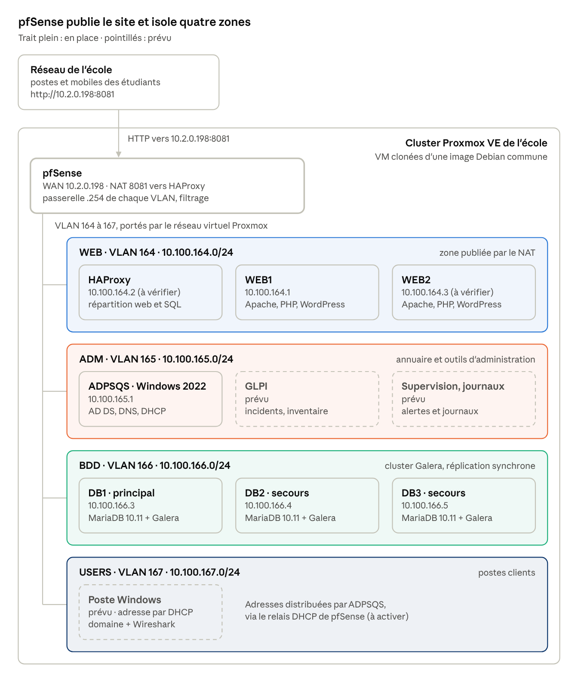

# Laboratoire SISR · projet Sentinelle

Dépôt du laboratoire de **Quentin Scarpa** : BTS SIO option SISR, épreuve E6 (session 2027), My Digital School Caen.

Le laboratoire publie un site WordPress qui reste en ligne quand un serveur tombe (réalisation **R1**). Le projet **Sentinelle** (réalisation **R2**) en fait le mini centre de sécurité d'une PME : supervision, journaux centralisés, détection d'intrusion, bastion et fichiers.

> État du dépôt : 29 octobre 2026 · DAT du laboratoire v1.4 · DAT R1 v0.1

## Sommaire

1. [Livrables E6](#livrables-e6)
2. [Architecture en bref](#architecture-en-bref)
3. [Technologies et procédures](#technologies-et-procédures)
4. [Relever les preuves](#relever-les-preuves)
5. [Rejouer le laboratoire](#rejouer-le-laboratoire)
6. [Démarrer et arrêter le laboratoire](#démarrer-et-arrêter-le-laboratoire)
7. [Organisation du dépôt](#organisation-du-dépôt)
8. [Conventions](#conventions)
9. [Points à vérifier](#points-à-vérifier)

## Livrables E6

Pièces remises au formateur, sur le modèle du dossier `nom-prenom/` du parcours U6 (gabarits et consignes, laissés tels quels).

| Pièce | Fichier | État |
| --- | --- | --- |
| Fiche descriptive R1 (mission N3) | [`01-fiche-descriptive-R1.md`](01-fiche-descriptive-R1.md) | Version 1 remise en S3, retour le 12 novembre |
| Fiche descriptive R2 | À créer (S13) | À faire |
| Tableau de l'environnement (annexe II.E) | [`03-environnement-annexe-II-E.md`](03-environnement-annexe-II-E.md) | Audit S3 : 7 lignes sur 22 démontrables |
| DAT d'environnement | [`docs/dat-environnement.md`](docs/dat-environnement.md) | Version 1.0 |
| Table de correspondance GSB | [`docs/correspondance-gsb.md`](docs/correspondance-gsb.md) | Version 1.0 |
| DAT du laboratoire, complet | [`docs/DAT.md`](docs/DAT.md) | Version 1.4 |
| DAT de la réalisation 1 | [`docs/dat-r1.md`](docs/dat-r1.md) | Version 0.1, à valider en S4 |
| Procédures | [`docs/procedures/`](docs/procedures/) | 01 à 08 |
| Plan de tests R1 | [`docs/tests/plan-de-tests-r1.md`](docs/tests/plan-de-tests-r1.md) | Prêt, à exécuter de S5 à S7 |
| Rapport de tests et rapport d'incident R1 | `docs/tests/` | À faire (S7) |
| Rendus de séance | [`seances/`](seances/) | S02 fait ; S01 (auto-diagnostic, règles du jeu) à rédiger soi-même |
| Preuves | `captures/`, `configs/`, `scripts/` | Scripts prêts, première collecte à lancer |

## Architecture en bref



Tout passe par **pfSense** : il publie le site sur son interface WAN (`10.2.0.198:8081`) et n'autorise entre les zones que les flux de la matrice (DAT §7).

| VLAN | Zone | Réseau | Contenu |
| --- | --- | --- | --- |
| 164 | WEB | 10.100.164.0/24 | HAProxy, WEB1, WEB2 |
| 165 | ADM | 10.100.165.0/24 | ADPSQS (Active Directory, DNS, DHCP) |
| 166 | BDD | 10.100.166.0/24 | DB1, DB2, DB3 (cluster Galera) |
| 167 | USERS | 10.100.167.0/24 | Postes clients (à venir) |

Chaîne web : **navigateur → pfSense (NAT) → HAProxy → WEB1 ou WEB2 → HAProxy → Galera (DB1, secours DB2 et DB3)**.

La cible Sentinelle est décrite dans le DAT : [`docs/DAT.md`](docs/DAT.md).

## Technologies et procédures

Une procédure par technologie en place, dans [`docs/procedures/`](docs/procedures/). Chacune contient : valeurs du labo, installation pas à pas, vérifications, dépannage, preuves à conserver pour le dossier E6.

| N° | Technologie | Rôle dans le labo | Machine(s) | État | Procédure |
| --- | --- | --- | --- | --- | --- |
| 01 | Proxmox VE | VM, réseau virtuel (VLAN), sauvegardes vzdump | Cluster de l'école | Partiel (sauvegardes à planifier) | [01-proxmox-vm-reseau.md](docs/procedures/01-proxmox-vm-reseau.md) |
| 02 | pfSense | Routage, filtrage, NAT, publication du site | pfSense (611) | Partiel | [02-pfsense.md](docs/procedures/02-pfsense.md) |
| 03 | OpenSSH et clés | Administration à distance sans mot de passe | Toutes les VM | En place | [03-ssh-par-cle.md](docs/procedures/03-ssh-par-cle.md) |
| 04 | Active Directory, DNS, DHCP | Domaine `qscarpa.lan`, noms, adresses | ADPSQS (606) | Partiel (DHCP à venir) | [04-active-directory-dns-dhcp.md](docs/procedures/04-active-directory-dns-dhcp.md) |
| 05 | Apache, PHP, WordPress | Le site public | WEB1 (609), WEB2 (615) | En place | [05-apache-php-wordpress.md](docs/procedures/05-apache-php-wordpress.md) |
| 06 | MariaDB et Galera | Base du site, réplication synchrone, contrôle de santé | DB1 (612), DB2 (613), DB3 (614) | En place | [06-mariadb-galera.md](docs/procedures/06-mariadb-galera.md) |
| 07 | HAProxy | Répartition web, bascule SQL | HAProxy (616) | En place | [07-haproxy.md](docs/procedures/07-haproxy.md) |
| 08 | Bascules et retour à la normale | Pannes, maintenance sans coupure, mesure des délais (R1) | HAProxy, WEB1, WEB2, DB1 à DB3 | Délais à mesurer | [08-bascules-et-retour-a-la-normale.md](docs/procedures/08-bascules-et-retour-a-la-normale.md) |

**Briques Sentinelle à venir** : GLPI, Prometheus / Grafana / Alertmanager, rsyslog puis Wazuh, Suricata, Guacamole (bastion), serveur de fichiers FS01, Nextcloud, Ansible, sauvegardes dédiées, HTTPS avec autorité interne, seconde instance HAProxy avec keepalived, assistant IA (bonus). Chacune recevra sa procédure au moment de sa mise en place, à partir du modèle [`00-modele.md`](docs/procedures/00-modele.md).

## Relever les preuves

Les procédures décrivent ce qui est attendu ; les preuves du dossier viennent des machines. Deux scripts, lancés depuis le poste d'administration, les relèvent sans rien modifier sur le labo.

```bash
scripts/collecte-preuves.sh
```

Il relève l'état de HAProxy, WEB1, WEB2 et DB1 à DB3 (versions, services, indicateurs, journaux) dans `captures/<technologie>/`, et leurs configurations réelles dans `configs/` et `scripts/`, mots de passe masqués.

```bash
scripts/mesure-bascule.sh http://10.2.0.198:8081/ 60 panne-web1
```

Il interroge le site toutes les 0,5 s pendant qu'une panne est provoquée dans un autre terminal, puis donne la plus longue interruption ([procédure 08](docs/procedures/08-bascules-et-retour-a-la-normale.md#47-mesurer-une-interruption)). Relire `git diff` avant chaque commit : les sorties contiennent les adresses du labo.

## Rejouer le laboratoire

Ordre conseillé pour reconstruire la chaîne web de zéro. Chaque étape dépend de la précédente.

1. **01 Proxmox** : créer les VM et les placer dans leur VLAN.
2. **02 pfSense** : interfaces, règles, NAT. Sans lui, les zones ne se voient pas.
3. **03 SSH** : accès par clé à toutes les VM.
4. **04 Active Directory et DNS** : noms des serveurs (le DNS doit répondre avant le reste).
5. **06 Galera** : la base doit exister avant WordPress.
6. **07 HAProxy** : WordPress vise HAProxy pour la base (`DB_HOST`).
7. **05 WordPress** : dernière brique, elle consomme toutes les autres.

## Démarrer et arrêter le laboratoire

Les VM sont éteintes entre les séances : chaque reprise est un démarrage à froid (DAT §15).

**Démarrage**

1. pfSense
2. ADPSQS (DNS et DHCP)
3. SIEM puis MON, quand ils existeront
4. Galera : amorcer **un seul** nœud, puis démarrer les deux autres un par un ([procédure 06](docs/procedures/06-mariadb-galera.md#5-démarrage-à-froid-et-reprise-après-panne))
5. HAProxy
6. WEB1 et WEB2
7. FS01, COLLAB et OPS, quand ils existeront
8. Vérifier : `wsrep_cluster_size` vaut 3, la page de statistiques HAProxy est au vert, le site répond sur `http://10.2.0.198:8081`

**Arrêt** : ordre inverse. Arrêter les nœuds Galera un par un et **noter le dernier arrêté** : c'est lui qu'on amorcera au prochain démarrage.

## Organisation du dépôt

```text
quentin-scarpa/
├── README.md                        Ce fichier
├── 01-fiche-descriptive-R1.md       Fiche descriptive de la réalisation 1
├── 03-environnement-annexe-II-E.md  Tableau de l'environnement (audit)
├── .gitignore                       Exclut secrets, clés et exports sensibles
├── docs/
│   ├── DAT.md                       Dossier d'architecture technique du laboratoire (v1.4)
│   ├── dat-environnement.md         Synthèse de l'existant
│   ├── correspondance-gsb.md        Zones et serveurs de GSB, équivalents dans le labo
│   ├── dat-r1.md                    DAT de la réalisation 1 (mission N3)
│   ├── img/                         Schémas utilisés par les DAT
│   ├── procedures/                  Une procédure par technologie, plus les bascules
│   │   ├── 00-modele.md
│   │   ├── 01-proxmox-vm-reseau.md
│   │   ├── 02-pfsense.md
│   │   ├── 03-ssh-par-cle.md
│   │   ├── 04-active-directory-dns-dhcp.md
│   │   ├── 05-apache-php-wordpress.md
│   │   ├── 06-mariadb-galera.md
│   │   ├── 07-haproxy.md
│   │   └── 08-bascules-et-retour-a-la-normale.md
│   └── tests/
│       └── plan-de-tests-r1.md      Plan de tests, tableau des pannes, test de charge
├── seances/                         Rendus de séance
├── scripts/                         collecte-preuves.sh, mesure-bascule.sh ; scripts relevés sur les machines
├── configs/                         Configurations relevées sur les machines, sans secret
├── ansible/                         Playbooks (phases Sentinelle)
└── captures/                        Preuves pour le dossier E6, un sous-dossier par technologie
```

`configs/`, `captures/` et `ansible/` sont encore vides : `scripts/collecte-preuves.sh` remplit les deux premiers à partir des machines ([Relever les preuves](#relever-les-preuves)).

## Conventions

- **Aucun secret dans le dépôt** : ni mot de passe, ni clé privée, ni `wp-config.php` réel. Les procédures utilisent des valeurs entre chevrons (`<MOT_DE_PASSE>`) à remplacer à la main.
- **« à vérifier »** : valeur reprise d'un échange, pas encore relevée sur la machine. La liste complète est au §18 du DAT.
- **Commits** : au moins un par séance, au format `type(portée): message`, par exemple :
  - `docs(galera): ajoute le démarrage à froid`
  - `config(haproxy): ajoute le contrôle de santé sur 9200`
  - `script(ad): enregistrements DNS des serveurs`
- **Procédures** : une technologie, un fichier, même plan que [`00-modele.md`](docs/procedures/00-modele.md). Toute commande est testée sur le labo avant d'être citée comme preuve.
- **Dépôt privé** recommandé tant que le dossier E6 n'est pas déposé : le dépôt décrit l'adressage et l'architecture d'un réseau.

## Points à vérifier

Les procédures sont rédigées à partir du DAT v1.4 : les adresses de HAProxy et de WEB2, les passerelles en `.254`, le mode du réseau virtuel Proxmox, la version de Debian et de Windows Server restent à relever sur les machines. Chaque procédure rappelle ses propres points ouverts ; la liste de référence est le [§18 du DAT](docs/DAT.md#18-points-à-vérifier).

## Licence

À définir avant de rendre le dépôt public. Les outils utilisés (Debian, Apache, MariaDB, Galera, HAProxy, WordPress) sont des logiciels libres ; Windows Server est sous licence (à préciser, DAT §3).
