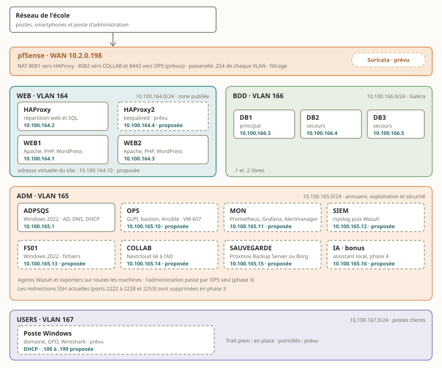
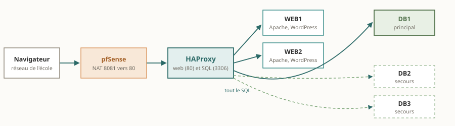
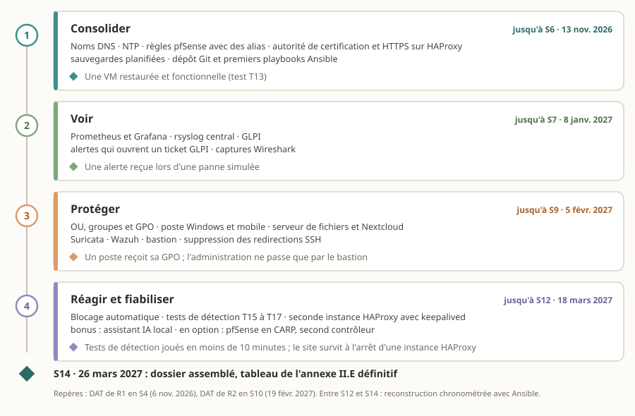
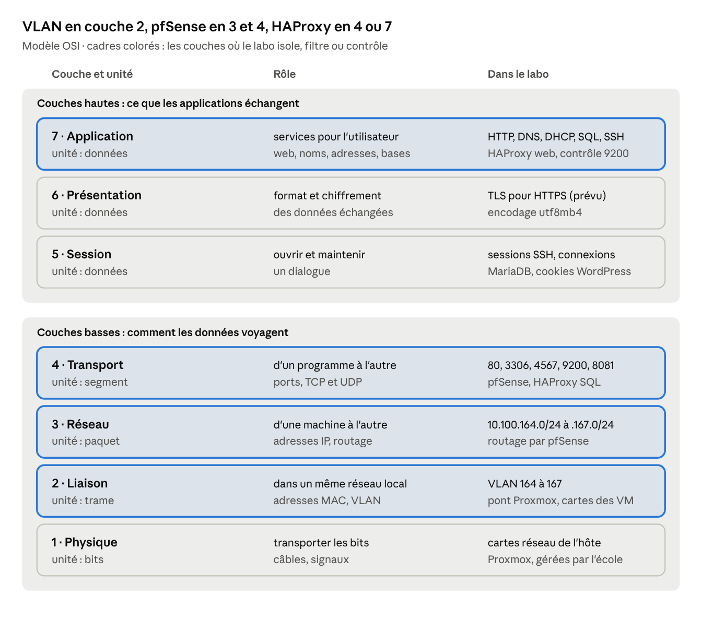
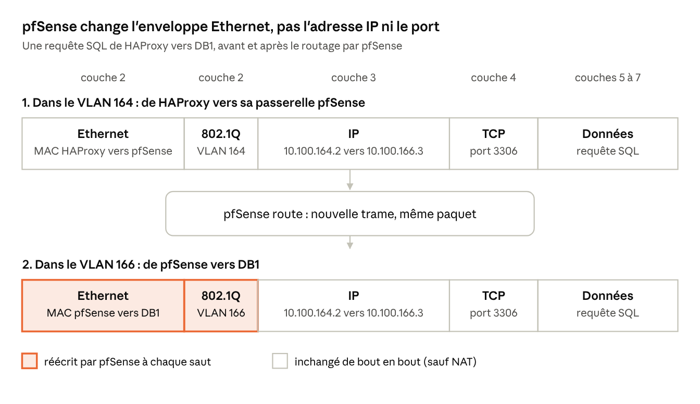
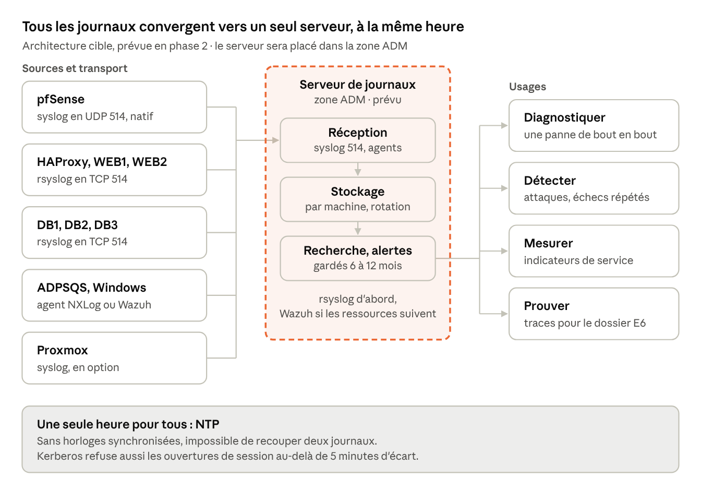

# DAT du laboratoire SISR

Version 1.4 · 8 octobre 2026 · Quentin Scarpa

Le laboratoire publie un site WordPress qui reste en ligne quand un serveur tombe. La cible, nommée Sentinelle, en fait le mini centre de sécurité d'une PME : supervision, journaux centralisés, détection d'intrusion, bastion et fichiers, avec une IA locale en bonus. Ce DAT décrit l'état actuel et cette cible, qui couvre l'annexe II.E, et sert de base aux DAT des réalisations R1 et R2.

## 1. Contexte et périmètre

Le laboratoire porte les deux réalisations professionnelles de l'épreuve E6 (BTS SIO option SISR, session 2027), préparées en ateliers U6 à My Digital School Caen.

- **Couvert** : tout ce qui tourne dans le laboratoire de l'école, des premiers labs de 1re année jusqu'au cluster Galera, et les briques prévues pour couvrir l'annexe II.E.
- **Projet** : la cible s'appelle Sentinelle. R1 porte sur la chaîne web haute disponibilité, R2 sur l'exploitation et la sécurité : supervision, journaux, détection d'intrusion, bastion et fichiers.
- **Exclu** : les projets menés hors de l'école, en entreprise ou à titre personnel.
- **Usage** : ce DAT alimente le dossier E6 (fiches descriptives, tableau de l'environnement, annexes). Il sert aussi de socle aux DAT de R1 (séance S4, 6 novembre 2026) et de R2 (S10, 19 février 2027).
- **Convention** : « à vérifier » signale une valeur reprise d'un échange, pas encore relevée sur la machine. Toutes sont listées au §18.

Compléments : Plan de tests · Matrice d'erreurs · Conformité annexe II.E · Lexique

## 2. Contexte d'entreprise cible

Le labo reproduit à petite échelle le réseau d'une PME qui publie un site web et gère ses postes. Le projet Sentinelle en fait le centre de sécurité de cette PME : le site reste en ligne, les machines sont supervisées, les attaques sont détectées puis bloquées. Le scénario ci-dessous explique pourquoi chaque brique existe et ce qu'une entreprise attendrait en production.

**Scénario fictif** : L'entreprise décrite n'existe pas : effectifs et enjeux sont des hypothèses de travail. Les services et leur état viennent du labo ; tout ce qui est marqué « À venir » figure dans la feuille de route (§17).

**L'entreprise du scénario**

| Élément | Hypothèse |
| --- | --- |
| Activité | Cabinet de conseil de 60 salariés, un site à Caen |
| Site web | Vitrine WordPress qui amène de nouveaux clients : chaque heure d'arrêt fait perdre des demandes de contact |
| Données | Coordonnées de prospects : des données personnelles, donc soumises au RGPD |
| Postes | 60 postes Windows joints au domaine, quelques mobiles |
| Équipe informatique | 2 personnes ; l'administrateur systèmes et réseaux est le rôle tenu dans le labo |
| Budget | Logiciels libres d'abord, licence Windows Server pour l'annuaire et le serveur de fichiers |
| Projet | Sentinelle : le labo joue le centre de sécurité de la PME ; une IA locale vient en bonus |

**Pourquoi cette architecture a du sens**

| Besoin de l'entreprise | Réponse dans le labo | Zone |
| --- | --- | --- |
| Le site vitrine doit rester en ligne | HAProxy répartit sur deux serveurs Apache | WEB |
| Les données de prospects ne doivent ni se perdre ni s'exposer | Galera copie en direct ; la base n'est joignable que depuis HAProxy | BDD |
| Chaque salarié ouvre sa session avec un compte unique et reçoit ses règles | Active Directory, DNS, DHCP et stratégies de groupe | ADM, USERS |
| Les fichiers sont partagés selon les droits de chacun, du poste comme du mobile | Serveur de fichiers par groupes AD et Nextcloud | ADM |
| Un poste compromis ne doit pas atteindre la base | Quatre VLAN, filtrage pfSense, refus par défaut | Toutes |
| Un administrateur ne se connecte pas directement aux serveurs | Bastion avec double authentification et enregistrement des sessions | ADM |
| Une panne se voit avant l'appel d'un utilisateur | Supervision, page de performances et alertes | ADM |
| Une attaque doit être vue et stoppée | Suricata, Wazuh et blocage automatique temporaire | pfSense, ADM |
| Chaque incident est tracé et le parc est connu | GLPI : tickets et inventaire | ADM |
| Les salariés veulent utiliser l'IA sans envoyer de données hors de l'entreprise | Assistant IA interne et local, sans appel à un service externe (bonus) | ADM |
| Après un incident, on retrouve ce qui s'est passé | Journaux centralisés, une seule heure pour tous | ADM |
| Une machine perdue se restaure | Sauvegardes Proxmox planifiées | Toutes |

**Services attendus**

| Service | Rôle en entreprise | Où dans le labo | État |
| --- | --- | --- | --- |
| Pare-feu pfSense | Filtre et isole les zones, publie le site | Passerelle de chaque VLAN | Partiel |
| HAProxy | Garde le site et l'accès SQL disponibles | VLAN 164 | En place |
| Apache, PHP, WordPress | Le site public | WEB1, WEB2 | En place |
| MariaDB et Galera | Données du site, copiées en direct | DB1, DB2, DB3 | En place |
| Active Directory | Comptes, groupes, stratégies (GPO) | ADPSQS | Partiel |
| DNS | Noms des serveurs et du domaine | ADPSQS | Partiel |
| DHCP et relais | Adresses des postes | ADPSQS, relais pfSense | À venir |
| NTP | Une seule heure pour tous | pfSense, ADPSQS | À vérifier |
| GLPI | Tickets et inventaire du parc | OPS | À venir |
| Supervision (Prometheus, Grafana, Alertmanager) | Indicateurs, page de performances et alertes | MON | À venir |
| Serveur de journaux (rsyslog, puis Wazuh) | Traçabilité, recherche, preuves | SIEM | À venir |
| Détection d'intrusion réseau (Suricata) | Repère les attaques contre le site | pfSense | À venir |
| Détection sur les machines et réponse (Wazuh) | Intégrité des fichiers, alertes, blocage temporaire d'une IP | SIEM et agents | À venir |
| Bastion (Guacamole, double authentification) | Point d'entrée unique de l'administration | OPS | À venir |
| Serveur de fichiers (partages par groupes AD) | Fichiers des services, droits, quotas, versions précédentes | FS01 | À venir |
| Espace collaboratif (Nextcloud lié à l'AD) | Fichiers, agenda et discussions, sur le poste et le mobile | COLLAB | À venir |
| Automatisation (Ansible, Git) | Configurations versionnées, reconstruction rapide | OPS | À venir |
| Sauvegardes Proxmox | Restauration d'une VM | Proxmox, SAUVEGARDE | Partiel |
| HTTPS et autorité de certification interne | Chiffre les échanges avec le site et l'annuaire | HAProxy, pfSense | À venir |
| Seconde instance HAProxy | Supprime le point unique de défaillance | HAProxy2 | À venir |
| Assistant IA interne (bonus) | Répond à partir de la documentation interne, aide au tri des alertes | IA | À venir |

**Agents et outils attendus**

| Agent ou outil | Installé sur | Rôle | État |
| --- | --- | --- | --- |
| Contrôle Galera (port 9200) | DB1, DB2, DB3 | Répond 200 seulement si le nœud est Synced et Primary | À vérifier |
| rsyslog | VM Linux | Envoie les journaux au serveur central, avant le passage à Wazuh | À venir |
| Agent Wazuh | VM Linux, ADPSQS, FS01, postes Windows | Journaux, intégrité des fichiers, détection, blocage local d'une IP | À venir |
| `node_exporter` et `windows_exporter` | VM Linux, serveurs et postes Windows | Indicateurs de performance lus par Prometheus | À venir |
| Agent GLPI | Postes Windows et serveurs | Remonte l'inventaire matériel et logiciel dans GLPI | À venir |
| keepalived | HAProxy et HAProxy2 | Fait basculer l'adresse virtuelle du site | À venir |
| Wireshark | Poste Windows en USERS | Capture les trames pour montrer les couches 2 à 7 | À venir |

**Un jour de panne**

1. Le nœud DB1 s'arrête.
2. Le contrôle sur le port 9200 échoue : HAProxy retire DB1 et envoie le SQL à un nœud de secours.
3. Le site continue de répondre : les deux Apache ne voient aucune interruption.
4. Alertmanager prévient l'administrateur et un ticket GLPI s'ouvre.
5. L'administrateur se connecte par le bastion et retrouve la cause dans les journaux centralisés, grâce à l'heure commune.
6. DB1 redémarre, se resynchronise avec le cluster, puis HAProxy le réintègre après des contrôles réussis.

**Une tentative d'intrusion, de bout en bout**

1. Depuis le poste Windows du VLAN USERS, des connexions SSH échouées se répètent vers OPS (règle pfSense temporaire).
2. Wazuh reconnaît la force brute (règle 5763) et bloque l'adresse source sur OPS, pour une durée limitée.
3. Un ticket GLPI s'ouvre et le tableau de bord montre l'événement.
4. L'administrateur lit l'alerte dans Wazuh, vérifie le blocage puis le lève.

**Lecture** : Les étapes 1 à 3 de la panne fonctionnent déjà dans le labo. Le reste dépend des phases 2 à 4 (§17).

## 3. Besoins, contraintes et cadre juridique

Le besoin central : un site web joignable depuis le réseau de l'école, qui survit à la perte d'un serveur web ou d'un serveur de base de données.

| Exigence | Type | Réponse dans le labo |
| --- | --- | --- |
| Publier un site joignable depuis le réseau de l'école | Fonctionnelle | WordPress publié par pfSense sur 10.2.0.198:8081 |
| Rester en ligne si un serveur web tombe | Disponibilité | Deux serveurs Apache derrière HAProxy |
| Rester en ligne si un serveur de base tombe | Disponibilité | Cluster Galera de 3 nœuds, bascule par HAProxy |
| Ne perdre aucune transaction validée | Intégrité | Réplication synchrone Galera |
| Séparer les rôles et limiter les flux | Sécurité | 4 VLAN, filtrage pfSense, refus par défaut |
| Centraliser comptes, noms et adresses | Exploitation | AD DS, DNS et DHCP sur ADPSQS |
| Rejouer et faire évoluer la solution en 1 h à l'examen | Exploitation | Procédures, scripts et configurations versionnés dans Git |
| Voir l'état des équipements et être alerté | Exploitation | Prometheus, Grafana, Alertmanager |
| Retrouver et détecter les événements de sécurité | Sécurité | Journaux centralisés, Suricata, Wazuh |
| Réserver l'administration à un point d'accès contrôlé | Sécurité | Bastion Guacamole avec double authentification |
| Partager des fichiers selon les droits de chacun | Fonctionnelle | Serveur de fichiers et Nextcloud liés à l'AD |
| Donner aux salariés une IA interne, sans envoi de données hors de l'entreprise | Fonctionnelle (bonus) | Assistant IA local |

**Contraintes**

- Hébergement imposé : cluster Proxmox de l'école, ressources partagées entre étudiants.
- Aucun équipement physique : pas de switch, tout le réseau est virtuel.
- Accès uniquement depuis le réseau de l'école, par l'interface WAN de pfSense (10.2.0.198).
- VM éteintes entre les séances : chaque reprise est un démarrage à froid, délicat pour Galera (§15).
- Ressources partagées : Sentinelle demande environ 15 vCPU et 29 Go de mémoire en permanence (§6), plus 4 vCPU et 8 Go si l'assistant IA est monté, à faire valider par l'école.
- Budget nul : logiciels libres, sauf Windows Server (annuaire et serveur de fichiers, licence à préciser).
- Calendrier : DAT de R1 en S4, dossier assemblé en S14 (26 mars 2027).
- Conformité : un environnement non conforme à l'annexe II.E coûte jusqu'à 15 points.

**Cadre juridique**

- RGPD : les comptes et commentaires WordPress, comme les adresses IP des journaux, sont des données personnelles. Collecte minimale, accès réservé aux administrateurs, conservation limitée : 6 mois à 1 an pour les journaux selon la [recommandation de la CNIL](https://www.cnil.fr/fr/la-cnil-publie-une-recommandation-relative-aux-mesures-de-journalisation).
- Licences : WordPress, MariaDB, Galera, HAProxy et Debian sont des logiciels libres (licences GPL). La licence de Windows Server reste à préciser.
- Outils de Sentinelle : Wazuh, Suricata, Prometheus, Grafana, Guacamole, Nextcloud et Ansible sont libres aussi ; leurs licences sont à relever avant le dépôt du dossier. La licence du modèle d'IA est aussi à relever : un modèle à poids ouverts n'est pas toujours un logiciel libre.
- Charte informatique de l'école : elle encadre l'usage du réseau et des ressources partagées.
- Secrets : aucun mot de passe dans ce document ni dans le dépôt Git.

## 4. Vue d'ensemble


*Figure 1 : vue d'ensemble, 4 zones, 8 VM en place, 3 prévues.*

Tout passe par pfSense : il publie le site sur son interface WAN et n'autorise entre les zones que les flux de la matrice (§7). Les cadres en pointillés sont prévus, pas encore en place.



*Figure 2 : architecture cible Sentinelle, quatre zones, adresses et outils d'exploitation.*

La cible ajoute, en zone ADM, les outils d'exploitation et de sécurité de Sentinelle. Les cadres en pointillés restent à monter (§17) et les adresses marquées « proposée » sont à confirmer (§18).

## 5. Évolution du laboratoire

Le laboratoire s'est construit par couches : chaque étape s'appuie sur la précédente et ajoute une compétence au dossier.

1. **Socle Proxmox** : création des VM à partir d'une même image Debian de base.
2. **Réseau** : pfSense en routeur et pare-feu, quatre VLAN (WEB, ADM, BDD, USERS).
3. **Annuaire** : Windows Server installé et configuré en PowerShell, avec AD DS, DNS et DHCP.
4. **Web** : serveurs Apache avec PHP et WordPress.
5. **Données** : trois serveurs MariaDB.
6. **Haute disponibilité des données** : les trois serveurs regroupés en cluster Galera.
7. **Point d'entrée unique** : HAProxy répartit le web sur deux Apache et bascule les accès SQL d'un nœud à l'autre.
8. **À venir** : le projet Sentinelle (§16 et §17) : supervision, journaux, détection d'intrusion, bastion, fichiers et démonstration d'attaque, pour couvrir l'annexe II.E.

## 6. Hébergement et inventaire

Toutes les machines sont des VM du cluster Proxmox VE de l'école (cluster à confirmer), sans équipement physique dédié.

- **Image de base** : les VM Linux sont clonées depuis une même image Debian. Leurs versions ne sont plus homogènes : à relever et à aligner.
- **Sauvegarde** : outil intégré de Proxmox (vzdump) pour l'instant. Une solution dédiée reste à déployer (§14).
- **Accès** : console Proxmox en secours, SSH par clé pour l'administration courante.

| Machine | ID Proxmox | Zone | Adresse IP | Système | Rôle et services | État |
| --- | --- | --- | --- | --- | --- | --- |
| pfSense | 611 | WAN et 4 VLAN | 10.2.0.198 (WAN), .254 par VLAN (à vérifier) | pfSense | Routage entre zones, filtrage, NAT, publication du site | En place |
| ADPSQS | 606 | ADM (165) | 10.100.165.1 | Windows Server 2022 | AD DS (domaine qscarpa.lan), DNS, DHCP | En place |
| HAProxy | 616 | WEB (164) | 10.100.164.2 (à vérifier) | Debian | Répartition HTTP vers WEB1 et WEB2, accès SQL vers Galera | En place |
| WEB1 | 609 | WEB (164) | 10.100.164.1 | Debian | Apache, PHP, WordPress | En place |
| WEB2 | 615 | WEB (164) | 10.100.164.3 (à vérifier) | Debian | Apache, PHP, WordPress | En place |
| DB1 | 612 | BDD (166) | 10.100.166.3 | Debian | MariaDB 10.11 et Galera, nœud principal | En place |
| DB2 | 613 | BDD (166) | 10.100.166.4 | Debian | MariaDB 10.11 et Galera, secours | En place |
| DB3 | 614 | BDD (166) | 10.100.166.5 | Debian | MariaDB 10.11 et Galera, secours | En place |
| OPS | 607 (créée, éteinte) | ADM (165) | 10.100.165.10 (proposée) | Debian | GLPI (incidents, inventaire), Guacamole (bastion) et poste de commande Ansible, en conteneurs ; la VM 607 existe déjà pour Guacamole | À venir |
| MON | à créer | ADM (165) | 10.100.165.11 (proposée) | Debian | Prometheus, Grafana et Alertmanager | À venir |
| SIEM | à créer | ADM (165) | 10.100.165.12 (proposée) | Debian | Réception centrale des journaux : rsyslog, puis Wazuh | À venir |
| FS01 | à créer | ADM (165) | 10.100.165.13 (proposée) | Windows Server 2022 | Serveur de fichiers : partages par groupes AD, quotas, versions précédentes | À venir |
| COLLAB | à créer | ADM (165) | 10.100.165.14 (proposée) | Debian | Nextcloud lié à l'AD, données sur FS01 | À venir |
| SAUVEGARDE | à créer | ADM (165) | 10.100.165.15 (proposée) | Debian | Proxmox Backup Server ou Borg, à choisir | À venir |
| HAProxy2 | à créer | WEB (164) | 10.100.164.4 (proposée) | Debian | Seconde instance HAProxy avec keepalived | À venir |
| IA (bonus) | à créer | ADM (165) | 10.100.165.16 (proposée) | Debian | Modèle de langage local et interface web, éteinte hors usage | À venir |
| Poste client | à créer | USERS (167) | DHCP, .100 à .199 (proposée) | Windows | Poste joint au domaine, Wireshark | À venir |
| Mobile | - | Réseau de l'école | DHCP de l'école | Smartphone | Second type de terminal, accès au site et à Nextcloud (NAT 8082) | À venir |

Console Proxmox au 8 octobre 2026 : les VM 606 (ADPSQS), 607 (Guacamole) et 621 (Debian) sont éteintes ; les sept autres sont allumées depuis 12 à 26 jours. Les VM Linux allumées ont deux vCPU et affichent 84 à 87 % de mémoire utilisée, à confirmer avec `free -h` avant d'ajouter les agents (§18). Le rôle de la VM 621 est à préciser (§18).

Les noms réels des VM suivent le préfixe SIO2527 (exemple : SIO2527-MariaDB-ADM-Quentin). Ce document emploie des noms courts.

**Où trouver une information manquante**

| Information | Où la relever |
| --- | --- |
| Version de Proxmox, nœuds du cluster | Proxmox : Centre de données, Résumé ; ou `pveversion` |
| Ressources d'une VM (processeurs, mémoire, disque) | Proxmox : la VM, onglet Matériel |
| Version de Debian | `cat /etc/debian_version` |
| Version de Windows Server | `winver` |
| Adresse et passerelle d'une VM | `ip -br a` et `ip route` (Linux), `ipconfig /all` (Windows) |
| Tâches de sauvegarde | Proxmox : Centre de données, Sauvegarde |


**Ressources prévues pour Sentinelle, estimation à valider avec l'école**

| VM | vCPU | Mémoire | Disque |
| --- | --- | --- | --- |
| SIEM (Wazuh) | 4 | 8 Go | 100 Go |
| SAUVEGARDE | 2 | 4 Go | 200 Go |
| FS01 | 2 | 4 Go | 80 Go |
| MON | 2 | 4 Go | 40 Go |
| OPS | 2 | 4 Go | 40 Go |
| COLLAB | 2 | 4 Go | 40 Go |
| HAProxy2 | 1 | 1 Go | 10 Go |
| **Total en permanence** | **15** | **29 Go** | **510 Go** |
| IA (bonus), éteinte hors usage | 4 | 8 Go | 40 Go |
| **Total avec l'IA** | **19** | **37 Go** | **550 Go** |
| Poste Windows, à la demande | 2 | 4 Go | 60 Go |

## 7. Réseau : zones, adressage et flux

Quatre VLAN séparent le web, l'administration, les données et les postes. pfSense est la seule porte entre eux et vers le réseau de l'école.

| VLAN | Zone | Réseau | Passerelle pfSense | Contenu | Adressage |
| --- | --- | --- | --- | --- | --- |
| 164 | WEB | 10.100.164.0/24 | 10.100.164.254 | HAProxy, WEB1, WEB2 ; HAProxy2 à venir | Fixe |
| 165 | ADM | 10.100.165.0/24 | 10.100.165.254 | ADPSQS ; OPS, MON, SIEM, FS01, COLLAB, sauvegarde et IA à venir | Fixe |
| 166 | BDD | 10.100.166.0/24 | 10.100.166.254 | DB1, DB2, DB3 | Fixe |
| 167 | USERS | 10.100.167.0/24 | 10.100.167.254 | Postes clients à venir | DHCP par ADPSQS |
| WAN | École | Réseau de l'école (masque à relever) | Passerelle de l'école | Interface WAN de pfSense : 10.2.0.198 | Fixe |

Passerelles en .254 : convention à vérifier dans pfSense, menu Interfaces.

**Adresses réservées par zone**

- **Règle** : adresses fixes de .1 à .99, DHCP de .100 à .199, passerelle pfSense en .254.
- **WEB (164)** : .1 WEB1, .2 HAProxy, .3 WEB2 ; .4 HAProxy2 et .10 adresse virtuelle du site (proposées).
- **ADM (165)** : .1 ADPSQS ; .10 OPS, .11 MON, .12 SIEM, .13 FS01, .14 COLLAB, .15 SAUVEGARDE, .16 IA (proposées).
- **BDD (166)** : .3 DB1, .4 DB2, .5 DB3 ; .1 et .2 libres.
- **USERS (167)** : .100 à .199 distribuées par ADPSQS (plage proposée).

**Redirections de ports sur l'interface WAN de pfSense (10.2.0.198)**

| Port WAN | Destination | Usage | État |
| --- | --- | --- | --- |
| 8081 | HAProxy, port 80 | Site publié | En place |
| 2222 | ADPSQS, SSH | Administration par clé | En place |
| 2223 | WEB1, SSH | Administration par clé | En place |
| 2224 | OPS (VM 607), SSH | Administration par clé | En place |
| 2225 | DB1, SSH | Administration par clé | En place |
| 2226 | DB2, SSH | Administration par clé | En place |
| 2227 | DB3, SSH | Administration par clé | En place |
| 2228 | WEB2, SSH | Administration par clé | En place |
| 2253 | HAProxy, SSH | Administration par clé | En place |
| 8082 | COLLAB, port 443 | Nextcloud | À venir |
| 8443 | OPS, port 443 | Bastion Guacamole | À venir |

Les redirections SSH viennent du fichier de configuration SSH du poste d'administration ; leur port de destination (22) est présumé. En phase 3, elles sont supprimées : l'administration passe par le bastion (8443), qui atteint les serveurs depuis la zone ADM (F25).


**Pourquoi quatre zones**

- **WEB** est publiée par le NAT : c'est la plus exposée. Elle n'ouvre vers ADM que l'envoi des journaux (F12 et F13).
- **BDD** contient les données : seul HAProxy y accède, sur les ports SQL et de contrôle.
- **ADM** détient l'annuaire et les outils : elle administre les autres zones, aucune ne l'administre. Exceptions de publication : Nextcloud (NAT 8082, F21) et le bastion (NAT 8443, F17), à valider (§18).
- **USERS** accueille les postes : zone la moins fiable, elle n'atteint que les services prévus.

**Réseau virtuel** : sans switch physique, les VLAN sont portés par le réseau virtuel de Proxmox. Un pont avec étiquettes VLAN relie chaque carte de VM à son VLAN, et pfSense reçoit tous les VLAN sur son interface interne ([documentation Proxmox](https://pve.proxmox.com/wiki/Network_Configuration)). Le mode exact (pont VLAN ou zone SDN) est à relever dans Proxmox.

**Matrice des flux**

| N° | Source | Destination | Service et port | Pourquoi | Passe par pfSense | État |
| --- | --- | --- | --- | --- | --- | --- |
| F1 | Réseau de l'école | 10.2.0.198:8081, redirigé vers HAProxy, port 80 | HTTP | Publication du site (NAT) | Oui | En place |
| F2 | HAProxy | WEB1, WEB2 | HTTP, TCP 80 | Répartition de charge | Non, même VLAN | En place |
| F3 | WEB1, WEB2 | HAProxy | MariaDB, TCP 3306 | WordPress vers la base | Non, même VLAN | À vérifier |
| F4 | HAProxy | DB1, DB2, DB3 | MariaDB, TCP 3306 | Requêtes SQL | Oui, WEB vers BDD | À vérifier |
| F5 | HAProxy | DB1, DB2, DB3 | Contrôle de santé, TCP 9200 | État Galera de chaque nœud | Oui, WEB vers BDD | À vérifier |
| F6 | DB1, DB2, DB3 | DB1, DB2, DB3 | Galera : TCP 4567, 4568, 4444 et UDP 4567 | Réplication et resynchronisation | Non, même VLAN | En place |
| F7 | Toutes les zones | ADPSQS | DNS, UDP et TCP 53 | Résolution des noms | Oui | À vérifier |
| F8 | USERS | ADPSQS | DHCP relayé par pfSense, UDP 67 et 68 | Adressage des postes | Oui | À venir |
| F9 | USERS | ADPSQS | Kerberos 88, LDAP 389, SMB 445, RPC 135 et plage dynamique, NTP 123 | Ouverture de session et GPO | Oui | À venir |
| F10 | Serveurs | Internet | HTTP et HTTPS, TCP 80 et 443 | Mises à jour | Oui, NAT sortant | À vérifier |
| F11 | Réseau de l'école (poste d'administration) | pfSense WAN, ports 2222 à 2228 et 2253, redirigés vers le port 22 de ADPSQS, OPS, WEB1, WEB2, DB1 à DB3 et HAProxy | SSH, TCP 22 | Administration actuelle par clé, supprimée en phase 3 | Oui, NAT | En place |
| F12 | Toutes les zones | Serveur de journaux (zone ADM) | Syslog, UDP et TCP 514 (TCP 6514 si chiffré) | Centralisation des journaux (§20) | Oui, sauf depuis ADM | À venir |
| F13 | Toutes les zones | SIEM (zone ADM) | Agent Wazuh : TCP 1514 (événements) et 1515 (enrôlement) | Détection sur les machines | Oui, sauf depuis ADM | À venir |
| F14 | MON (zone ADM) | Serveurs et postes de toutes les zones | `node_exporter` TCP 9100, `windows_exporter` TCP 9182, autres exporters à relever | Performances des équipements | Oui, de ADM vers les autres zones | À venir |
| F15 | Alertmanager | GLPI (OPS) | HTTPS, TCP 443, API de GLPI | Ticket ouvert automatiquement | Non, même VLAN | À venir |
| F16 | OPS et COLLAB | HAProxy (accès SQL vers Galera) | MariaDB, TCP 3306 | Bases de GLPI et de Nextcloud, une base et un compte par outil | Oui, de ADM vers WEB | À venir |
| F17 | Réseau de l'école (poste d'administration) | 10.2.0.198:8443, redirigé vers OPS, port 443 | HTTPS, TCP 443 | Administration par le bastion (NAT) | Oui | À venir |
| F18 | USERS | FS01 | SMB, TCP 445 | Partages de fichiers par groupes AD | Oui | À venir |
| F19 | USERS | COLLAB | HTTPS, TCP 443 | Espace collaboratif | Oui | À venir |
| F20 | COLLAB | ADPSQS et FS01 | LDAPS TCP 636, SMB TCP 445 | Authentification AD et stockage des fichiers | Non, même VLAN | À venir |
| F21 | Réseau de l'école (smartphone) | 10.2.0.198:8082, redirigé vers COLLAB, port 443 | HTTPS | Nextcloud sur le mobile (NAT) | Oui | À venir |
| F22 | Proxmox | SAUVEGARDE | Proxmox Backup Server, TCP 8007 | Sauvegarde des VM | À vérifier : réseau d'administration de Proxmox | À venir |
| F23 | HAProxy | HAProxy2 | VRRP, protocole 112 | Adresse virtuelle du site | Non, même VLAN | À venir |
| F24 | USERS (poste client) | OPS | SSH, TCP 22 | Test de force brute, règle ouverte pendant le test | Oui, règle temporaire | À venir |
| F25 | OPS (bastion et Ansible) | Serveurs des zones WEB, BDD et ADM | SSH, TCP 22 ; RDP, TCP 3389 | Administration depuis la zone ADM | Oui, de ADM vers les autres zones | À venir |
| F26 | USERS | IA (zone ADM) | HTTPS, TCP 443 | Assistant IA (bonus) | Oui | À venir |
| F27 | OPS (script relais) | IA | API locale du serveur de modèles, port à relever | Aide au tri des alertes (bonus) | Non, même VLAN | À venir |
| F28 | Toute autre source | Toute destination | Tous | Refus par défaut, journalisé | Oui | À vérifier |

Les règles pfSense gagnent à utiliser des alias, des groupes nommés d'adresses et de ports : une règle reste juste quand une adresse change ([documentation pfSense](https://docs.netgate.com/pfsense/en/latest/firewall/aliases.html)). Ports Active Directory : [documentation Microsoft](https://learn.microsoft.com/en-us/troubleshoot/windows-server/networking/service-overview-and-network-port-requirements).

## 8. Annuaire, DNS et DHCP

ADPSQS (Windows Server 2022, 10.100.165.1) porte le domaine qscarpa.lan, le DNS interne et le DHCP. Il est en place mais encore peu exploité.

- **Installation** : rôles et promotion en contrôleur de domaine réalisés en PowerShell. Le script est à verser dans le dépôt Git.
- **DNS** : zone qscarpa.lan intégrée à l'annuaire. Le redirecteur vers l'extérieur est à vérifier avec `Get-DnsServerForwarder`.
- **DHCP** : rôle installé sur ADPSQS. Pour servir la zone USERS, pfSense doit relayer les demandes vers 10.100.165.1. Le relais impose de couper le serveur DHCP de pfSense sur ces interfaces ([documentation pfSense](https://docs.netgate.com/pfsense/en/latest/services/dhcp/relay.html)).
- **Limite constatée** : les serveurs Linux ne sont pas déclarés dans le DNS. C'est la cause de l'erreur WordPress E03 de la matrice d'erreurs.

**Installation de référence**, à comparer au script réel ([documentation Microsoft](https://learn.microsoft.com/en-us/windows-server/identity/ad-ds/deploy/install-active-directory-domain-services--level-100-)) :

```powershell
Install-WindowsFeature -Name AD-Domain-Services, DNS, DHCP -IncludeManagementTools
Install-ADDSForest -DomainName 'qscarpa.lan'
```

**Déclarer un serveur dans le DNS**, avec sa zone inverse :

```powershell
Add-DnsServerPrimaryZone -NetworkId '10.100.164.0/24' -ReplicationScope 'Forest'
Add-DnsServerResourceRecordA -ZoneName 'qscarpa.lan' -Name 'web1' -IPv4Address '10.100.164.1' -CreatePtr
```

**Préparer l'étendue DHCP de la zone USERS** (plage .100 à .199 proposée) :

```powershell
Add-DhcpServerInDC -DnsName 'adpsqs.qscarpa.lan' -IPAddress 10.100.165.1
Add-DhcpServerv4Scope -Name 'USERS' -StartRange 10.100.167.100 -EndRange 10.100.167.199 -SubnetMask 255.255.255.0
Set-DhcpServerv4OptionValue -ScopeId 10.100.167.0 -Router 10.100.167.254 -DnsServer 10.100.165.1 -DnsDomain 'qscarpa.lan'
```

**Reste à faire**

- [ ] Déclarer chaque serveur dans le DNS : enregistrements A et PTR, une zone inverse par VLAN.
- [ ] Faire pointer le DNS des VM Linux vers 10.100.165.1.
- [ ] Structurer l'annuaire : une OU par usage, des groupes, des comptes nominatifs et des comptes de service.
- [ ] Créer une GPO de base (mot de passe, verrouillage de session) et la tester sur un poste USERS.
- [ ] Activer le relais DHCP sur pfSense et l'étendue 10.100.167.0/24 sur ADPSQS.


**Rôles ajoutés par Sentinelle**

- **Groupes de partages** : modèle AGDLP pour FS01. Les comptes entrent dans un groupe global par service, ce groupe dans un groupe local de domaine par partage, et ce dernier reçoit les droits NTFS.
- **LDAPS** : COLLAB et Guacamole interrogent l'annuaire en LDAPS (TCP 636), avec un certificat de l'autorité interne.
- **Autorité interne** : elle signe les certificats de HAProxy, de LDAPS et des interfaces web. Le gestionnaire de certificats de pfSense suffit ; AD CS est une option (§18).
- **Machines jointes au domaine** : FS01 et les postes Windows. COLLAB et Guacamole utilisent l'annuaire sans y être joints.
- [ ] Créer les groupes de partages et les OU de FS01, COLLAB et des postes.

## 9. Chaîne web haute disponibilité

Une requête entre par le NAT de pfSense, puis HAProxy la confie à l'un des deux Apache. WordPress lit et écrit ensuite la base via HAProxy, qui n'envoie les requêtes qu'au nœud principal.



*Figure 3 : chaîne haute disponibilité, du navigateur au cluster Galera.*

Le trait plein vers DB1 porte tout le trafic SQL ; les pointillés vers DB2 et DB3 ne servent qu'en cas de panne.

**Réglages clés**

- **Web** : HAProxy répartit à tour de rôle entre WEB1 et WEB2 et contrôle chaque serveur en HTTP. Un Apache en panne est retiré, puis réintégré dès qu'il répond.
- **SQL** : DB1 est actif, DB2 et DB3 sont déclarés en secours (`backup`). Un seul nœud reçoit les écritures, ce qui évite les conflits entre nœuds Galera.
- **Ordre de secours** : DB2 prend le relais si DB1 tombe, DB3 seulement si DB2 tombe aussi. Quand DB1 revient, HAProxy lui rend la main ([HAProxy](https://www.haproxy.com/blog/failover-and-worst-case-management-with-haproxy)).
- **Contrôle de santé** : sur chaque nœud, un petit service répond sur le port 9200, avec le code 200 seulement si le nœud est Synced et Primary. Tester le seul port 3306 ne suffit pas : un nœud isolé accepte les connexions mais refuse les requêtes.
- **Coupure franche** : `on-marked-down shutdown-sessions` ferme les connexions vers un nœud déclaré en panne, pour que PHP se reconnecte aussitôt au suivant.
- **Page de statistiques** : port 8404, protégée par mot de passe, à n'ouvrir que depuis la zone ADM.
- **WordPress** : `DB_HOST` vise HAProxy (10.100.164.2). `WP_HOME` et `WP_SITEURL` valent `http://10.2.0.198:8081`, l'adresse vue depuis le réseau de l'école ([documentation wp-config](https://developer.wordpress.org/advanced-administration/wordpress/wp-config/)).

**Points d'attention avec deux serveurs web**

- Les deux `wp-config.php` doivent être identiques, clés et sels compris. Sinon, changer de serveur invalide les cookies de connexion et l'utilisateur est déconnecté ([documentation WordPress](https://developer.wordpress.org/apis/wp-config-php/)).
- Les fichiers téléversés (`wp-content/uploads`) n'existent que sur le serveur qui les a reçus. Un partage commun ou une synchronisation reste à choisir (§18).
- HAProxy est un point unique de défaillance. Une seconde instance avec keepalived et une adresse virtuelle est prévue (§17).

**Configuration de référence**, à comparer avec `/etc/haproxy/haproxy.cfg` :

```
frontend site_web
    bind 10.100.164.2:80
    default_backend apache

backend apache
    balance roundrobin
    option forwardfor
    option httpchk GET /
    server web1 10.100.164.1:80 check
    server web2 10.100.164.3:80 check

listen galera
    bind 10.100.164.2:3306
    mode tcp
    option tcplog
    timeout client 1h
    timeout server 1h
    option httpchk
    http-check send meth GET uri / ver HTTP/1.1 hdr Host galera
    http-check expect status 200
    default-server check port 9200 inter 3s fall 2 rise 3 on-marked-down shutdown-sessions
    server db1 10.100.166.3:3306
    server db2 10.100.166.4:3306 backup
    server db3 10.100.166.5:3306 backup
```

## 10. Cluster Galera

Les trois nœuds MariaDB 10.11 répliquent chaque transaction de façon synchrone. Une transaction validée sur DB1 a déjà été transmise à DB2 et DB3 : la panne de DB1 ne fait perdre aucune transaction validée.

- **Quorum** : le cluster ne sert des requêtes que s'il réunit plus de la moitié des nœuds. Avec trois nœuds, il survit à la panne d'un nœud. Après deux pannes brutales, le dernier nœud passe en non-Primary et refuse les requêtes, pour éviter des données divergentes ([documentation MariaDB](https://mariadb.com/docs/galera-cluster/high-availability/understanding-quorum-monitoring-and-recovery)).
- **Nœud principal** : Galera accepte les écritures sur tous les nœuds, mais HAProxy n'en envoie qu'à DB1. Des écritures simultanées sur deux nœuds peuvent entrer en conflit à la validation et faire échouer des transactions.
- **Retour d'un nœud** : il rattrape les transactions manquées (IST, port 4568) ou recopie toute la base depuis un autre nœud (SST, port 4444).
- **Contraintes** : tables InnoDB uniquement, et une clé primaire sur chaque table ([limites connues](https://mariadb.com/docs/galera-cluster/reference/mariadb-galera-cluster-known-limitations)). À vérifier avant d'y héberger la base d'un nouvel outil.
- **Démarrage à froid** : quand les trois nœuds sont arrêtés, aucun ne repart seul. Il faut amorcer le plus à jour avec `galera_new_cluster`, puis démarrer les autres un par un (schéma de décision dans la matrice d'erreurs, E01).

**Les indicateurs à connaître**, lus sur chaque nœud avec `sudo mariadb -e "SHOW STATUS LIKE 'wsrep%'"` :

| Variable | Valeur attendue | Ce qu'elle dit |
| --- | --- | --- |
| wsrep\_cluster\_size | 3 | Nombre de nœuds dans le cluster |
| wsrep\_cluster\_status | Primary | Le nœud fait partie du groupe majoritaire |
| wsrep\_local\_state\_comment | Synced | Le nœud est à jour |
| wsrep\_ready | ON | Le nœud accepte les requêtes |

## 11. Choix techniques

Chaque brique a été comparée à au moins une alternative. La dernière colonne donne le critère qui a tranché.

| Besoin | Solution retenue | Alternative écartée | Pourquoi ce choix |
| --- | --- | --- | --- |
| Hyperviseur | Proxmox VE | Aucune, fourni par l'école | Imposé ; sauvegarde intégrée, gratuit |
| Pare-feu | pfSense | OPNsense | Outil vu en cours, interface web, paquets comme Suricata. OPNsense ferait aussi bien |
| Annuaire | Active Directory sur Windows Server 2022 | Samba AD sur Debian | Référence en entreprise, GPO natives, second système exigé par l'annexe II.E |
| Serveur web | Apache | Nginx | Compatible WordPress sans réglage (fichiers .htaccess), déjà maîtrisé |
| Réplication | Galera, synchrone, 3 nœuds | Réplication maître-esclave, asynchrone | Aucune transaction validée perdue, bascule sans intervention. Coût : 3 nœuds minimum |
| Accès à la base | HAProxy avec contrôle de santé | keepalived seul, ProxySQL | Déjà en place pour le web, vérifie l'état Galera et pas seulement le port. Limite : point unique tant qu'il est seul |
| Répartition web | HAProxy | DNS à tour de rôle | Retire un serveur en panne, alors que le DNS continuerait de l'annoncer |
| Supervision et performances | Prometheus, Grafana, Alertmanager | Zabbix | Tableaux de bord libres et visuels, un exporter par brique du labo, alertes reliées à GLPI. Zabbix aurait fait aussi bien avec un seul outil |
| Journaux et détection sur les machines | rsyslog, puis Wazuh | Graylog, pile Elastic seule | Un outil pour les journaux, l'intégrité des fichiers, la détection et le blocage ; agents Linux et Windows. Coût : 4 vCPU et 8 Go |
| Détection réseau | Suricata sur pfSense | Snort | Paquet de pfSense, alertes envoyées à Wazuh |
| Bastion | Apache Guacamole | JumpServer, Teleport | Accès par navigateur en SSH et RDP, double authentification TOTP, enregistrement des sessions ([manuel](https://guacamole.apache.org/doc/gug/totp-auth.html)) |
| Espace collaboratif | Nextcloud | ownCloud, partage Samba seul | Fichiers, agenda et discussions dans une application, comptes AD, application mobile |
| Serveur de fichiers | Windows Server (SMB, FSRM) | Samba sur Debian | Droits NTFS par groupes AD, quotas et versions précédentes intégrés ; coût : une licence |
| Automatisation | Ansible et Git | Scripts seuls | Reconstruction rejouable en moins d'une heure, configurations versionnées |

**Coût, délai, qualité, environnement**

- **Coût** : nul hors licences Windows Server (annuaire et serveur de fichiers) ; tout le reste est libre.
- **Délai** : les briques sont montées pendant les séances U6 et doivent se rejouer en 1 h à l'examen.
- **Qualité** : bascule automatique pour le web et pour la base ; HAProxy reste le point faible.
- **Environnement et éthique** : VM dimensionnées au plus juste et éteintes hors séance, logiciels libres et auditables, données personnelles réduites au minimum.

## 12. Analyse d'impact des évolutions

Chaque évolution déplace un flux ou une dépendance. Ce tableau liste ce qu'il faut adapter avant de la lancer.

| Évolution | Ce qui est touché | Risque | Mesure |
| --- | --- | --- | --- |
| HAProxy placé devant Galera | Comptes MariaDB, règles pfSense, wp-config.php | Accès refusé : MariaDB voit l'adresse de HAProxy, plus celle du serveur web | Créer le compte WordPress pour 10.100.164.2, ouvrir 3306 et 9200 depuis HAProxy |
| Second serveur Apache | wp-config.php, fichiers téléversés, cible du NAT | Déconnexions, images manquantes | wp-config.php identique, partage des téléversements, NAT vers HAProxy |
| HTTPS sur HAProxy | Certificat, adresses WordPress, NAT | Boucle de redirection, alerte de certificat | Certificat d'une autorité interne, WP\_HOME en https, en-tête X-Forwarded-Proto transmis à WordPress |
| Déclaration DNS des serveurs | Zone qscarpa.lan, réseau des VM Linux | Un nom qui pointe vers une mauvaise adresse | Créer A et PTR, tester avec nslookup avant de remplacer une IP par un nom |
| Supervision et GLPI | Nouveaux flux d'agents, nouvelles bases | Flux oubliés, charge sur Galera | Ajouter les flux à la matrice, une base et un compte par outil |
| Mise à jour de Debian ou de MariaDB | Nœuds Galera | Versions incompatibles dans le cluster | Un nœud à la fois, sauvegarde avant, attendre Synced entre deux nœuds |
| Agents Wazuh sur toutes les VM | Flux TCP 1514 et 1515, charge des VM | Flux oublié, serveur de journaux saturé | Flux F13 dans la matrice, 4 vCPU et 8 Go pour SIEM, alerte sur le disque |
| Blocage automatique d'une IP | Règles locales de la VM visée | Se bloquer soi-même | Poste d'administration en liste blanche, durée de blocage limitée, essais d'abord depuis le poste client du VLAN USERS |
| Bastion seule porte d'administration | Règle F11, accès SSH et RDP | Perdre l'accès si OPS tombe | Console Proxmox en secours, OPS sauvegardée |
| Nextcloud et serveur de fichiers | Comptes AD, LDAPS, partage SMB, NAT 8082 | Droits trop larges, publication d'une zone ADM | Groupes AGDLP, port 8082 limité au réseau de l'école, point à valider (§18) |
| Assistant IA (bonus) | Charge du cluster, flux F26 et F27 | Cluster ralenti, fuite de données | VM éteinte hors usage, modèle local, aucun appel externe, priorité la plus basse |
| Suppression des redirections SSH (2222 à 2228, 2253) | Accès d'administration de toutes les VM | Perdre l'accès si le bastion ne fonctionne pas | Supprimer après validation du bastion, console Proxmox en secours |

## 13. Sécurité

La sécurité repose sur trois piliers : des zones séparées, des flux limités au strict nécessaire et des comptes aux droits minimaux.

| Mesure | Ce qu'elle protège | État |
| --- | --- | --- |
| 4 VLAN filtrés par pfSense, refus par défaut journalisé | Propagation d'une attaque d'une zone à l'autre | À vérifier |
| Un seul port publié (8081, vers HAProxy) | Surface exposée au réseau de l'école | En place |
| Base accessible depuis HAProxy uniquement | Données du site | À vérifier |
| Compte WordPress limité à sa base wp2026 | Autres bases du cluster | En place |
| Compte du contrôle de santé sans aucun privilège | Données, si le script fuit | À vérifier |
| SSH par clé | Vol ou devinette de mot de passe | En place |
| Page de statistiques HAProxy protégée | Informations sur l'infrastructure | À vérifier |
| Mots de passe forts, jamais écrits dans la documentation | Accès non autorisé | Partiel |
| HTTPS sur le site | Identifiants WordPress envoyés en clair | À venir |
| Mises à jour régulières | Failles connues | Partiel |
| Détection d'intrusion (Suricata sur pfSense) | Attaques contre le site publié | À venir |
| Journaux conservés et consultés | Traçabilité, obligations RGPD | À venir |
| Bastion avec double authentification (TOTP) et enregistrement des sessions | Accès d'administration | À venir |
| Administration réservée à OPS par règle pfSense (F11) | Accès direct aux serveurs | À venir |
| Contrôle d'intégrité de `wp-config.php` par Wazuh | Modification discrète du site | À venir |
| Blocage automatique temporaire d'une IP après force brute | Devinette de mots de passe | À venir |
| Droits des partages par groupes AD | Fichiers des autres services | À venir |
| Certificats d'une autorité interne (HTTPS, LDAPS) | Écoute des échanges | À venir |
| Accès SSH par redirections de ports WAN (2222 à 2228, 2253), authentification par clé | Accès d'administration à distance | En place |

Le point « mots de passe » reste partiel : un mot de passe de test, utilisé pendant la mise en place de Galera, est encore à remplacer.

## 14. Continuité, sauvegarde et contrat de service

Le site tient la perte d'un serveur web ou d'un nœud de base. HAProxy, pfSense et l'annuaire restent des points uniques de défaillance.

**Modes dégradés**

| Panne | Effet sur le site | Reprise |
| --- | --- | --- |
| WEB1 ou WEB2 | Aucun : HAProxy retire le serveur | Redémarrer Apache, le serveur est réintégré automatiquement |
| DB1, nœud principal | Coupure de quelques secondes, bascule sur DB2 | DB1 se resynchronise, puis reprend la main |
| Deux nœuds Galera, panne brutale | Site en erreur : le dernier nœud passe en non-Primary | Amorcer le nœud le plus à jour (E01) |
| Les trois nœuds, extinction | Site en erreur jusqu'au redémarrage | Démarrage à froid (§15, E01) |
| HAProxy | Site injoignable | Redémarrer la VM ; cible : une paire avec keepalived |
| pfSense | Tout le labo injoignable | Console Proxmox, restauration de la configuration ; option : paire CARP |
| ADPSQS | Plus de DNS ni de DHCP ; le site continue, il utilise des IP | Restaurer la VM ; option : second contrôleur |
| SIEM ou MON | Aucun sur le site ; plus de journaux centralisés ni de tableau de bord | Redémarrer la VM ; les événements de la coupure restent sur chaque machine |
| OPS | Aucun sur le site ; plus de GLPI, de bastion ni d'Ansible | Console Proxmox pour l'accès, restauration de la VM |
| FS01 ou COLLAB | Aucun sur le site ; partages et Nextcloud indisponibles | Restaurer la VM ou une version précédente du fichier |

**Sauvegarde**

- **En place** : sauvegarde intégrée de Proxmox (vzdump). Elle produit des sauvegardes complètes des VM, planifiables, avec une durée de conservation ([documentation Proxmox](https://pve.proxmox.com/wiki/Backup_and_Restore)).
- **À définir** : planning, conservation, copie hors du cluster, et surtout une restauration testée (test T13).
- **Base de données** : un export logique quotidien depuis un nœud de secours complète les images de VM, par exemple `mariadb-dump --all-databases --single-transaction` sur DB3.
- **Fichiers** : FS01 garde des versions précédentes des fichiers et fait partie de la sauvegarde des VM ; les données de Nextcloud sont stockées sur FS01.
- **Cible** : Proxmox Backup Server ou BorgBackup, à choisir.

**Contrat de service proposé** (ligne 14 de l'annexe II.E, valeurs à valider)

| Engagement | Valeur proposée | Comment le mesurer |
| --- | --- | --- |
| Pannes tolérées sans coupure | 1 serveur web ou 1 nœud de base | Tests T08 et T10 |
| Perte de données si un nœud tombe | Aucune transaction validée | Tests T05 et T08 |
| Perte de données maximale (RPO) | 24 h, avec une sauvegarde quotidienne | Date de la dernière sauvegarde réussie |
| Délai de rétablissement (RTO) | 30 min après un arrêt complet | Chronométré au test T11 |
| Disponibilité pendant les séances | Site joignable dès la fin du démarrage | Page de statistiques HAProxy, puis supervision |
| Alerte après la panne d'un nœud de base | Moins de 2 min | Test S2 (T16) |
| Blocage d'une force brute SSH | Dans la minute qui suit le seuil de la règle | Test S1 (T15) |

## 15. Exploitation et administration

L'administration passe par SSH avec clé et par la console Proxmox ; avec Sentinelle, elle passe par le bastion (§16). Les configurations et les scripts sont versionnés dans le dépôt Git du parcours.

**Ordre de démarrage après une période d'arrêt**

1. pfSense : routage et filtrage.
2. ADPSQS : DNS et DHCP.
3. SIEM puis MON : les agents et les exporters retrouvent leur serveur.
4. Galera : amorcer UN nœud, puis démarrer les deux autres un par un (schéma de la matrice d'erreurs, E01).
5. HAProxy.
6. WEB1 et WEB2.
7. FS01, COLLAB et OPS.
8. Vérifier : `wsrep_cluster_size` vaut 3, la page de statistiques HAProxy est au vert, le site répond sur http://10.2.0.198:8081. Grafana affiche toutes les machines.

**Arrêt** : ordre inverse. Arrêter les nœuds Galera un par un et noter le dernier arrêté : c'est lui qu'on amorcera au prochain démarrage.

**Où lire les journaux**

| Élément | Ce qu'on y trouve | Où le lire |
| --- | --- | --- |
| pfSense | Flux autorisés et refusés, NAT | Status > System Logs > Firewall |
| HAProxy | Requêtes, serveurs retirés ou réintégrés | `/var/log/haproxy.log` ou `journalctl -u haproxy` |
| Apache | Accès et erreurs du site | `/var/log/apache2/access.log` et `error.log` |
| MariaDB et Galera | Démarrage, état du cluster, réplication | `journalctl -u mariadb` |
| ADPSQS | Annuaire, DNS, DHCP | Observateur d'événements : journaux Directory Service, DNS Server, DHCP Server |
| Suricata | Alertes réseau | Services > Suricata > Alerts, puis Wazuh |
| Wazuh | Alertes de sécurité, intégrité des fichiers, blocages | Interface web de Wazuh (SIEM) |
| Grafana | Performances de chaque équipement | Page Grafana (MON) |

Détail des journaux, de leurs usages et de la centralisation prévue : §20.

**Gestion des configurations**

- Dépôt Git du parcours, avec les dossiers `docs/`, `scripts/`, `configs/`, `ansible/` et `captures/`, et au moins un commit par séance.
- À versionner : `haproxy.cfg`, la configuration Galera sans mot de passe, le script et les unités systemd du contrôle de santé, les scripts PowerShell de l'annuaire.
- Ansible, depuis OPS : playbooks pour les agents Wazuh, les exporters, HAProxy et les règles ; connexion SSH par clé, secrets dans Ansible Vault. Objectif : reconstruire une machine en moins d'une heure.
- La configuration de pfSense s'exporte depuis Diagnostics > Backup & Restore. Le fichier contient des empreintes de mots de passe : il reste dans un dépôt privé.

## 16. Sentinelle : exploitation et sécurité

Sentinelle regroupe les briques qui font du labo le centre de sécurité d'une PME : voir l'état des machines, centraliser et analyser les événements, détecter et bloquer une attaque, administrer par un point unique, partager des fichiers. Tout tourne en zone ADM, sauf Suricata (sur pfSense).

**Supervision et performances**

- **Outils** : Prometheus lit les indicateurs, Grafana les affiche, Alertmanager envoie les alertes. Les VM concernées sont MON et OPS.
- **Sources** : `node_exporter` sur les VM Linux, `windows_exporter` sur les machines Windows, et les exporters de MariaDB, de HAProxy et de Proxmox (flux F14).
- **Page de performances** : un tableau de bord par zone. Il montre le processeur, la mémoire, le disque et le réseau de chaque VM, l'état de Galera (`wsrep_cluster_size`, `wsrep_local_state_comment`), les serveurs HAProxy en ligne et le trafic de pfSense.
- **Alertes** : Alertmanager prévient par mail ou Discord. Un petit script relais transforme l'alerte en ticket GLPI, par l'API de GLPI (F15).

**Journaux et détection**

- **Centralisation** : rsyslog en phase 2, puis Wazuh en phase 3 si l'école accorde 4 vCPU et 8 Go de mémoire (§20). Les agents Wazuh tournent sur les VM Linux, ADPSQS, FS01 et les postes (F13).
- **Détection réseau** : Suricata sur pfSense, en détection d'abord. Ses alertes arrivent dans Wazuh par syslog.
- **Détection sur les machines** : règles de Wazuh et contrôle d'intégrité de `wp-config.php` et de `/etc`.
- **Réponse** : le script `firewall-drop` fourni par Wazuh bloque l'adresse source sur la VM visée pendant une durée limitée, par exemple après la règle 5763 de force brute SSH ([documentation Wazuh](https://documentation.wazuh.com/current/user-manual/capabilities/active-response/ar-use-cases/blocking-ssh-brute-force.html)). Un blocage au niveau de pfSense demanderait un script écrit pour le labo : c'est une option.

**Bastion**

- **Guacamole** sur OPS donne accès aux serveurs en SSH et en RDP depuis un navigateur. Les comptes viennent de l'annuaire (LDAPS) et un second facteur TOTP s'ajoute ([manuel Guacamole](https://guacamole.apache.org/doc/gug/totp-auth.html)). Les sessions sont enregistrées.
- **Règle pfSense** : SSH et RDP vers les serveurs n'acceptent plus que OPS (F25). Les redirections SSH actuelles sont alors supprimées (§7). La console Proxmox reste le secours.
- **Poste d'administration** : il atteint le bastion en HTTPS par le NAT 8443 (F17) et figure dans la liste blanche du blocage automatique.

**Fichiers et espace collaboratif**

- **FS01** : un partage par service, droits NTFS par groupes AD (modèle AGDLP), quotas et versions précédentes (F18).
- **COLLAB** : Nextcloud, connexion par les comptes AD (LDAPS), données lues sur FS01 par SMB, base MariaDB sur Galera (F16, F19, F20). Il est joignable depuis le poste et depuis le smartphone par le NAT 8082 (F21).

**Automatisation et configurations**

- **Ansible**, lancé depuis OPS, déploie les agents, les exporters, la configuration de HAProxy et les règles, par SSH avec clé. Les playbooks vivent dans le dépôt Git, les secrets dans Ansible Vault.
- **GLPI** tient l'inventaire : l'agent GLPI remonte les postes et les serveurs.

**Assistant IA (bonus, phase 4)**

- **Rôle** : un assistant interne, sur la VM IA en zone ADM. Il n'est pas nécessaire à l'annexe II.E : s'il est arrêté, rien d'autre ne s'arrête.
- **Documentation** : il répond aux techniciens à partir du DAT, des procédures et de la matrice d'erreurs. Par exemple, « Galera ne redémarre pas » renvoie à la procédure E01.
- **Tri des alertes** : pour une alerte Wazuh ou Suricata, il propose un résumé, une cause probable et un lien vers la procédure, que le script relais ajoute au ticket GLPI. L'administrateur valide ; l'IA ne bloque et ne modifie rien.
- **Principe** : modèle local, sans appel à un service externe : aucun journal ni donnée personnelle ne quitte l'école (RGPD). Accès par les comptes AD (F26, F27).
- **Garde-fous** : les journaux contiennent du texte contrôlé par un attaquant, qui peut tenter d'injecter des instructions dans le modèle ; l'IA n'a donc aucune action automatique. Ses réponses peuvent être fausses : elles sont toujours relues.
- **Ressources et licence** : environ 4 vCPU et 8 Go avec un petit modèle, plus lent sur processeur ; à mesurer (§6). La licence du modèle est à relever (§3).
- **Outils** : un serveur de modèles local et une interface web, par exemple Ollama et Open WebUI, à choisir en phase 4.

**Tests de détection**

| N° | Test | Action | Ce qu'on doit voir | Test |
| --- | --- | --- | --- | --- |
| S1 | Force brute | Connexions SSH échouées répétées depuis le poste Windows de USERS vers OPS (F24) | Règle 5763, adresse bloquée un temps, ticket GLPI | T15 |
| S2 | Panne d'un nœud | Arrêt de DB1 | HAProxy bascule, le site reste en ligne, alerte et ticket | T16 |
| S3 | Intégrité | Modification de `wp-config.php` sur WEB1 (intrusion simulée) | Alerte d'intégrité dans Wazuh | T17 |

Les tests se jouent depuis le labo, sans poste d'attaque dédié. Les tests T15 à T17 sont à ajouter au plan de tests.

**Parcours de démonstration**

1. Le chemin d'une requête : du navigateur au site, par pfSense, HAProxy, Apache et Galera, puis la page Grafana de chaque équipement.
2. Une panne : arrêt de DB1 (test S2), alerte reçue, ticket GLPI, retour à la normale.
3. Une évolution en direct : ajout d'une machine ou d'un service avec Ansible (par exemple WEB3 ou l'assistant IA). La nouvelle machine apparaît dans HAProxy, Grafana, Wazuh et l'inventaire GLPI.

## 17. Feuille de route

Quatre phases mènent le labo à la conformité complète avant l'assemblage du dossier en S14 (26 mars 2027).



*Figure 4 : feuille de route, 4 phases, de novembre 2026 à mars 2027.*

Chaque phase se termine par un critère vérifiable, prouvé par un test du plan de tests. Les échéances reprennent les séances U6 et leurs points d'étape.

## 18. Points à vérifier

Ces valeurs viennent d'échanges, pas d'un relevé sur les machines. Elles sont à confirmer avant le dépôt du dossier.

- [ ] Adresses de HAProxy (10.100.164.2 retenue ici) et de WEB2 (10.100.164.3 retenue ici).
- [ ] Passerelles pfSense en .254 sur chaque VLAN.
- [ ] Cible de la redirection 8081 : HAProxy, ou encore WEB1.
- [ ] Masque et passerelle du réseau de l'école, côté WAN de pfSense.
- [ ] Proxmox : cluster ou nœud seul, version, réseau virtuel (pont VLAN ou SDN).
- [ ] Version de Debian sur chaque VM, version de Windows Server sur ADPSQS.
- [ ] Redirecteur DNS d'ADPSQS et état du relais DHCP sur pfSense.
- [ ] Licence de Windows Server : évaluation ou licence de l'école, pour ADPSQS et FS01.
- [ ] Ressources accordées à Sentinelle : environ 15 vCPU et 29 Go de mémoire en permanence, plus 4 vCPU et 8 Go pour l'IA (§6).
- [ ] Adresses IP réelles de chaque VM : les relever (`ip -br a` sous Linux, `ipconfig /all` sous Windows) et les comparer aux §6 et §7. Réserver les adresses proposées.
- [ ] Redirections SSH : confirmer que chacune vise le port 22 et que le NAT 8443 vers OPS est accepté.
- [ ] VM 607 et VM 621 : rôle exact et ressources (la 607 doit devenir OPS).
- [ ] Mémoire des VM Linux (84 à 87 % utilisée) : vérifier avec `free -h` avant d'ajouter Wazuh et les exporters.
- [ ] Publication de Nextcloud par le NAT 8082, seule publication hors WEB (F21).
- [ ] Autorité de certification interne : gestionnaire de certificats de pfSense ou AD CS.
- [ ] Chemin des sauvegardes de Proxmox vers SAUVEGARDE (F22) : passe-t-il par pfSense ?
- [ ] Licences des outils de Sentinelle à relever (§3).
- [ ] Partage des fichiers téléversés entre WEB1 et WEB2 : NFS ou synchronisation.
- [ ] Réglages HAProxy réels, comparés à la configuration de référence du §9.
- [ ] Planning et conservation des sauvegardes Proxmox.

## 19. Modèle OSI appliqué au labo

Le modèle OSI ([norme ISO/IEC 7498-1](https://www.iso.org/standard/20269.html)) découpe une communication réseau en sept couches. Chaque couche rend un service à celle du dessus et s'appuie sur celle du dessous. Dans le labo, il sert à placer chaque protection au bon niveau et à diagnostiquer dans l'ordre.



*Figure 5 : modèle OSI, 7 couches, dont 4 où le labo agit.*

Les cadres colorés marquent les quatre couches où une brique du labo isole, filtre ou contrôle : 2 (VLAN), 3 et 4 (pfSense), 4 et 7 (HAProxy).

Dans la pratique, Internet suit le modèle TCP/IP, qui fond les couches 5 à 7 en une seule couche « application ». Le modèle OSI reste la grille commune pour concevoir et diagnostiquer.

**Comment ça marche : l'encapsulation**

À l'envoi, chaque couche ajoute son propre en-tête à ce que lui donne la couche du dessus, comme une enveloppe glissée dans une autre. Exemple : HAProxy transmet une requête SQL à DB1.

1. Couches 7 à 5 : la requête SQL elle-même, ce sont les données.
2. Couche 4 : TCP l'emballe dans un segment, avec le port de destination 3306.
3. Couche 3 : IP en fait un paquet, de 10.100.164.2 (HAProxy) vers 10.100.166.3 (DB1).
4. Couche 2 : Ethernet en fait une trame, adressée à la MAC de la passerelle pfSense, dans le VLAN 164.
5. Couche 1 : la carte réseau envoie les bits.

À la réception, chaque couche retire son en-tête dans l'ordre inverse et passe le reste à la couche du dessus.



*Figure 6 : encapsulation, une trame du labo avant et après pfSense.*

En routant, pfSense jette l'ancienne trame et en construit une nouvelle pour le VLAN 166 : la couche 2 change à chaque saut, les couches 3 et 4 vont de bout en bout. C'est ce que montre Wireshark en capturant des deux côtés de pfSense.

L'étiquette VLAN n'existe qu'entre le pont Proxmox et pfSense : une VM ne la voit jamais. Le NAT est la seule exception à la règle du schéma : il réécrit l'adresse et le port de destination, 10.2.0.198:8081 devenant 10.100.164.2:80.

**Comment nous l'appliquons**

| Action | Ce que fait le labo | Couches |
| --- | --- | --- |
| Isoler | Les VLAN séparent les zones dès la couche 2 : deux VM de VLAN différents ne se joignent pas sans passer par pfSense | 2 |
| Filtrer | pfSense décide selon les adresses (couche 3) et les ports (couche 4) ; la matrice des flux (§7) en est la traduction | 3 et 4 |
| Publier | Le NAT réécrit l'adresse et le port de destination pour rendre HAProxy joignable depuis l'école | 3 et 4 |
| Répartir | HAProxy relaie le SQL en couche 4 (mode tcp, sans lire les requêtes) et le web en couche 7 (mode http, il lit chaque requête) | 4 et 7 |
| Contrôler | Le contrôle Galera passe par HTTP sur le port 9200 (couche 7) : tester seulement le port 3306 (couche 4) ne verrait pas un nœud non-Primary | 4 et 7 |
| Analyser | Wireshark affiche chaque trame couche par couche : Ethernet, IP, TCP, puis l'application (lignes 12 et 15 de l'annexe II.E) | 2 à 7 |
| Diagnostiquer | La méthode de la matrice d'erreurs remonte les couches dans l'ordre (tableau suivant) | 1 à 7 |

**Lien avec la méthode de diagnostic**

| Étape de la matrice d'erreurs | Couches OSI vérifiées |
| --- | --- |
| 1 · VM et réseau virtuel | 1 et 2 |
| 2 · Adressage IP | 3 |
| 3 · Routage et filtrage | 3 et 4 |
| 4 · Résolution de noms | 7 (DNS), vérifiée tôt car tout ce qui suit en dépend |
| 5 · Port distant | 4 |
| 6 · Service et application | 5 à 7 |

## 20. Journaux : emplacements, usages et centralisation

Chaque machine écrit ses propres journaux : ils disent ce qui s'est passé, quand et où. Aujourd'hui, ils restent sur chaque machine ; un serveur central est prévu pour les réunir.

**Où les trouver**

Depuis Debian 12, rsyslog n'est plus installé par défaut. Les journaux système sont dans le journal systemd, lu avec `journalctl`, et `/var/log/syslog` n'existe que si rsyslog est installé ([notes de version de Debian 12](https://www.debian.org/releases/bookworm/amd64/release-notes/ch-information.en.html)).

| Machine | Journal | Où le lire | Ce qu'on y trouve |
| --- | --- | --- | --- |
| pfSense | Pare-feu | Status > System Logs > Firewall | Flux autorisés et bloqués : règle, source, destination, port |
| pfSense | Système, DHCP, NTP | Status > System Logs, onglets System et DHCP | Services, baux, synchronisation de l'heure |
| HAProxy | Requêtes et bascules | `journalctl -u haproxy`, ou `/var/log/haproxy.log` si rsyslog est installé | Client, serveur choisi, code HTTP, durée ; serveurs retirés ou réintégrés |
| WEB1, WEB2 | Accès Apache | `/var/log/apache2/access.log` | Chaque requête : page, code HTTP, adresse (celle de HAProxy, sauf réglage X-Forwarded-For) |
| WEB1, WEB2 | Erreurs Apache | `/var/log/apache2/error.log` | Erreurs PHP et Apache |
| DB1 à DB3 | MariaDB et Galera | `journalctl -u mariadb` | Démarrages, état WSREP, arrivées et départs de nœuds, SST et IST |
| Toutes les VM Linux | Système | `journalctl -b` (démarrage en cours), `journalctl -p err` (erreurs) | Tous les services de la machine |
| Toutes les VM Linux | Connexions SSH | `journalctl -u ssh` | Connexions acceptées et refusées, avec l'adresse source |
| ADPSQS | Sécurité | Observateur d'événements, journal Sécurité | Ouvertures de session réussies (4624) et échouées (4625) |
| ADPSQS | Annuaire, DNS | Journaux Directory Service et DNS Server | Réplication, erreurs de résolution |
| ADPSQS | DHCP | Journal DHCP Server et fichiers `C:\Windows\System32\dhcp\DhcpSrvLog-*.log` | Baux attribués et refusés |
| Proxmox | Tâches et système | Journal des tâches de l'interface, et Nœud > Système > Syslog | Démarrages de VM, sauvegardes, erreurs |

**À quoi ils servent**

| Usage | Exemple dans le labo | Journal à lire |
| --- | --- | --- |
| Diagnostiquer une panne | L'erreur gcomm de Galera (E01) | `journalctl -u mariadb` |
| Prouver qu'un flux est bloqué | Le flux WEB vers ADM refusé (T03) | Pare-feu pfSense |
| Repérer une attaque | Une rafale d'échecs SSH, ou de sessions Windows (4625) | SSH, journal Sécurité |
| Mesurer la qualité de service | Codes HTTP, temps de réponse, bascules de serveurs | HAProxy |
| Tracer l'administration | Qui s'est connecté, quand, depuis quelle adresse | SSH, Sécurité, Proxmox |
| Prouver pour le dossier E6 | Extraits commentés en annexe (sous-compétence 15) | Tous |

**Règles de gestion**

- **Rotation** : les fichiers tournent avec logrotate (`/etc/logrotate.d/`). Le journal systemd est plafonné par `SystemMaxUse` dans `/etc/systemd/journald.conf`.
- **Conservation** : 6 mois à 1 an, selon la recommandation de la CNIL citée au §3.
- **Horodatage** : toutes les machines doivent avoir la même heure (NTP). Sans cela, impossible de recouper deux journaux, et Kerberos refuse les sessions au-delà de 5 minutes d'écart.
- **Accès** : réservé aux administrateurs, car les journaux contiennent des adresses IP et des identifiants.

**Centralisation prévue**

Aujourd'hui, suivre une requête de bout en bout oblige à ouvrir cinq consoles. Un serveur de journaux, en zone ADM, réunira tout au même endroit. Il gardera aussi une copie hors d'atteinte si une machine tombe ou est compromise.



*Figure 7 : centralisation des journaux, 5 sources, 1 serveur, 4 usages.*

Le serveur reçoit, range par machine puis permet de chercher et d'alerter ; la bande du bas rappelle la condition pour que tout cela ait un sens : la même heure partout.

| Solution | Principe | Ressources | Atout | Limite |
| --- | --- | --- | --- | --- |
| rsyslog central | Un serveur Debian reçoit le syslog de toutes les machines et l'écrit dans un dossier par machine | Très faibles | Natif, rapide à monter, robuste | Pas d'interface de recherche ; agent nécessaire pour Windows |
| Grafana Loki | Journaux indexés par étiquettes, consultés dans Grafana, collectés par l'agent Alloy | Faibles | S'intègre à Grafana si la supervision l'utilise | Promtail, l'ancien agent, n'est plus maintenu depuis mars 2026 ([Grafana](https://grafana.com/docs/loki/latest/send-data/promtail/)) |
| Graylog | Collecte, recherche et alertes dans une interface web | Élevées : Graylog, MongoDB et Data Node ([Graylog](https://go2docs.graylog.org/current/downloading_and_installing_graylog/ubuntu_installation.htm)) | Recherche puissante, flux et alertes | Trois services à faire tourner dans le labo |
| Wazuh | Plateforme de sécurité : collecte, analyse, détection d'intrusion, agents Linux et Windows | Élevées : 4 vCPU et 8 Go en tout-en-un ([Wazuh](https://documentation.wazuh.com/current/quickstart.html)) | Couvre aussi les lignes 10 et 26 de l'annexe II.E | Plus lourd, prise en main plus longue |

**Recommandation** : rsyslog en phase 2, léger et rapide à prouver, puis Wazuh en phase 3 si l'école accorde 4 vCPU et 8 Go de mémoire (§6). Un seul outil couvre alors la centralisation, la recherche, la détection et le blocage temporaire d'une adresse.

**Emplacement** : la VM SIEM, en zone ADM, reçoit rsyslog en phase 2 puis Wazuh en phase 3.

**Mise en œuvre avec rsyslog**, configuration de référence à adapter :

```
# Serveur central : /etc/rsyslog.d/10-reception.conf
module(load="imudp")
input(type="imudp" port="514")
module(load="imtcp")
input(type="imtcp" port="514")
template(name="ParMachine" type="string" string="/var/log/central/%HOSTNAME%/%PROGRAMNAME%.log")
if $fromhost-ip != '127.0.0.1' then {
    action(type="omfile" dynaFile="ParMachine")
    stop
}
```

```
# Chaque VM Linux : apt install rsyslog, puis /etc/rsyslog.d/90-central.conf
# @@ envoie en TCP, un seul @ enverrait en UDP
*.* @@journaux.qscarpa.lan:514
```

- **pfSense** : Status > System Logs, onglet Settings, case « Send log messages to remote syslog server ». pfSense n'envoie qu'en UDP, d'où l'écoute UDP 514 côté serveur ([documentation pfSense](https://docs.netgate.com/pfsense/en/latest/monitoring/logs/remote.html)).
- **ADPSQS** : un agent convertit les journaux d'événements Windows en syslog (NXLog Community Edition), ou l'agent Wazuh si cette solution est retenue.
- **Apache** : ses fichiers se lisent avec le module imfile de rsyslog.
- **Flux à ouvrir** (F12 de la matrice des flux) : toutes les zones vers le serveur de journaux, en UDP et TCP 514. Avec Wazuh : TCP 1514 et 1515 (F13) ([ports Wazuh](https://documentation.wazuh.com/current/getting-started/architecture.html)).
- **Chiffrement** : syslog sur TLS utilise le port TCP 6514 ([RFC 5425](https://www.rfc-editor.org/rfc/rfc5425)).
- **Validation** : test T14 du plan de tests.

## Sources

**Documents du parcours** (archive U6-Atelier-Pro) : Mon parcours U6, Mon laboratoire (checklist de l'annexe II.E), grille nationale d'évaluation E6 SISR (annexes 9-5-A et 9-6, session 2026), outil d'appréciation de l'environnement technologique (annexe VII-7).

**Documentation technique consultée le 1er octobre 2026**

- [Galera : quorum, surveillance et reprise](https://mariadb.com/docs/galera-cluster/high-availability/understanding-quorum-monitoring-and-recovery), MariaDB
- [Galera : configuration et ports](https://mariadb.com/docs/galera-cluster/galera-management/configuration/configuring-mariadb-galera-cluster), MariaDB
- [Galera : limites connues](https://mariadb.com/docs/galera-cluster/reference/mariadb-galera-cluster-known-limitations), MariaDB
- [Galera : premiers pas et amorçage](https://mariadb.com/docs/galera-cluster/galera-management/installation-and-deployment/getting-started-with-mariadb-galera-cluster), MariaDB
- [Redémarrer un cluster Galera](https://galeracluster.com/library/training/tutorials/restarting-cluster.html), Galera Cluster
- [Bascule et serveurs de secours](https://www.haproxy.com/blog/failover-and-worst-case-management-with-haproxy), HAProxy
- [Relais DHCP](https://docs.netgate.com/pfsense/en/latest/services/dhcp/relay.html), [alias](https://docs.netgate.com/pfsense/en/latest/firewall/aliases.html) et [journalisation distante](https://docs.netgate.com/pfsense/en/latest/monitoring/logs/remote.html), pfSense
- [Sauvegarde et restauration](https://pve.proxmox.com/wiki/Backup_and_Restore) et [configuration réseau](https://pve.proxmox.com/wiki/Network_Configuration), Proxmox VE
- [Installer AD DS](https://learn.microsoft.com/en-us/windows-server/identity/ad-ds/deploy/install-active-directory-domain-services--level-100-) et [ports réseau de Windows](https://learn.microsoft.com/en-us/troubleshoot/windows-server/networking/service-overview-and-network-port-requirements), Microsoft
- [wp-config.php : clés de sécurité](https://developer.wordpress.org/apis/wp-config-php/) et [adresses du site](https://developer.wordpress.org/advanced-administration/wordpress/wp-config/), WordPress
- [Recommandation sur la journalisation](https://www.cnil.fr/fr/la-cnil-publie-une-recommandation-relative-aux-mesures-de-journalisation), CNIL
- [Modèle de référence OSI, ISO/IEC 7498-1](https://www.iso.org/standard/20269.html), ISO
- [Changements de la journalisation dans Debian 12](https://www.debian.org/releases/bookworm/amd64/release-notes/ch-information.en.html), Debian
- [Syslog sur TLS, RFC 5425](https://www.rfc-editor.org/rfc/rfc5425), IETF
- [Installation rapide](https://documentation.wazuh.com/current/quickstart.html) et [ports requis](https://documentation.wazuh.com/current/getting-started/architecture.html), Wazuh
- [Fin de vie de Promtail](https://grafana.com/docs/loki/latest/send-data/promtail/), Grafana
- [Installation d'un nœud Graylog](https://go2docs.graylog.org/current/downloading_and_installing_graylog/ubuntu_installation.htm), Graylog

**Documentation technique consultée le 2 octobre 2026**

- [Authentification TOTP](https://guacamole.apache.org/doc/gug/totp-auth.html), Apache Guacamole
- [Blocage d'une force brute SSH par réponse active](https://documentation.wazuh.com/current/user-manual/capabilities/active-response/ar-use-cases/blocking-ssh-brute-force.html) et [scripts de réponse active fournis](https://documentation.wazuh.com/current/user-manual/capabilities/active-response/default-active-response-scripts.html), Wazuh

## Versions du document

| Version | Date | Changement |
| --- | --- | --- |
| 1.4 | 8 octobre 2026 | Retrait de la zone ATTAQUE et de Kali, assistant IA en bonus, identifiants Proxmox, redirections de ports et plan d'adressage complété, tests de détection T15 à T17 |
| 1.3 | 2 octobre 2026 | Projet Sentinelle : zone ATTAQUE, nouveaux services, flux F13 à F25, chapitre 16 (§16), feuille de route révisée, tests T15 à T18 |
| 1.2 | 2 octobre 2026 | Ajout du contexte d'entreprise cible (§2) |
| 1.1 | 1er octobre 2026 | Ajout du modèle OSI (§19), des journaux et de leur centralisation (§20), test T14 |
| 1.0 | 1er octobre 2026 | Première version : état actuel, cible, plan de tests, matrice d'erreurs, conformité à l'annexe II.E |
