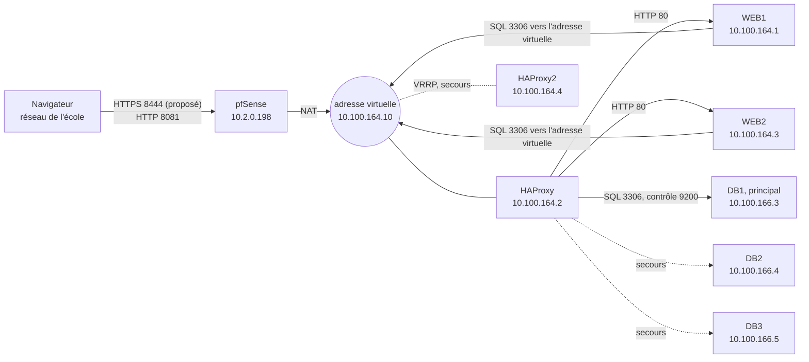

# DAT de la réalisation 1 · haute disponibilité de l'application de suivi des visites

Version 0.1 · 29 octobre 2026 · Quentin Scarpa · Mission GSB N3

> Première version, rédigée en S3 avec la fiche descriptive R1, à revoir en S4 (6 novembre 2026). Elle s'appuie sur le [DAT d'environnement](dat-environnement.md) et renvoie au [DAT du laboratoire](DAT.md) pour le détail. Aucun résultat de test n'y figure encore : les mesures se consignent dans le [plan de tests R1](tests/plan-de-tests-r1.md).

## 1. Besoin de GSB et périmètre

**Besoin.** L'application de suivi des visites et des frais est l'outil quotidien des 480 visiteurs médicaux de métropole. Une panne les empêche d'enregistrer leurs visites et retarde le remboursement de leurs frais. La DSI demande que l'application continue de fonctionner si un serveur web tombe, et que la base soit répliquée pour reprendre vite. Les données de GSB ne tolèrent ni fuite ni destruction.

**Charge de travail.** Le code de référence de l'application (`visite.gsb.coop`) est fourni par le formateur et n'est pas modifié. En attendant de le recevoir, WordPress tient ce rôle sur la même chaîne : même pile (Apache, PHP, MariaDB), mêmes tests.

**Mission retenue** : N3, socle (lots 1, 2 et 4) et extension (lot 3, redondance du répartiteur).

**Ce qui existe et ce que la réalisation ajoute**

| Élément de N3 | Déjà en place dans le labo | Ajouté par la réalisation | Lot |
| --- | --- | --- | --- |
| Deux serveurs web | WEB1, WEB2 : Apache, PHP, site identique | Maintien de session si l'application l'exige ; reprise des requêtes sur l'autre serveur (`option redispatch`) | 1 |
| Répartiteur | HAProxy en HTTP, contrôle d'état des Apache | HTTPS avec un certificat de l'autorité interne ; preuve de la répartition | 1 |
| Administration à distance | SSH par clé, une redirection pfSense par machine | Accès limité au poste d'administration (alias `ADMIN_PC`), journal exploité | 1 |
| Base répliquée | Grappe Galera de 3 nœuds, bascule SQL par HAProxy | Mise à l'épreuve mesurée : panne de DB1, retour, perte du quorum, démarrage à froid ; un seul écrivain au retour de DB1 | 2 |
| Plan de continuité | Modes dégradés décrits (DAT §14) | Objectifs RTO et RPO justifiés, [procédure 08](procedures/08-bascules-et-retour-a-la-normale.md), tableau des pannes testées, export logique restauré | 4 |
| Redondance du répartiteur | Aucune | HAProxy2 et keepalived, adresse virtuelle `10.100.164.10` | 3 |

**Exigences**

| N° | Exigence | Critère d'acceptation | Tests |
| --- | --- | --- | --- |
| EX1 | L'application s'ouvre en HTTPS à travers le répartiteur | Certificat émis par l'autorité interne, code 200 | R1-T01 |
| EX2 | La panne d'un serveur web ne coupe pas le service, sans intervention humaine | Aucune erreur à l'arrêt d'Apache ; interruption de 10 s au plus à l'arrêt brutal de la VM | R1-T03, R1-T04 |
| EX3 | La panne de la base principale ne perd aucune transaction validée | Interruption de 15 s au plus, données retrouvées | R1-T06, R1-T07 |
| EX4 | Le répartiteur n'est plus un point unique (extension) | L'adresse virtuelle bascule en 5 s au plus | R1-T13, R1-T14 |
| EX5 | L'administration se fait par clé, depuis le poste d'administration, et elle est tracée | Mot de passe refusé, autre source refusée, connexions visibles dans le journal | R1-T11 |
| EX6 | Les données restent protégées sur chaque copie | La base n'est joignable que depuis HAProxy | R1-T12 |
| EX7 | Une suppression accidentelle se rattrape | Données retrouvées depuis l'export quotidien en 1 h au plus | R1-T15 |
| EX8 | Un seul serveur web tient la charge | Aucun échec au test de charge, avec un et deux serveurs | R1-T10 |

## 2. Cadre juridique

- **Données personnelles (RGPD)** : l'application traite des données de salariés (visiteurs : identité, notes de frais) et de praticiens (identité, coordonnées, visites). L'article 32 du RGPD demande des moyens de garantir « la disponibilité et la résilience constantes » des systèmes, de « rétablir la disponibilité des données […] dans des délais appropriés » après un incident, et une procédure pour « tester, analyser et évaluer régulièrement » ces mesures. C'est l'objet même de R1 : bascules automatiques, puis testées et mesurées.
- **Copies** : chaque nœud Galera et chaque sauvegarde est une copie complète des données personnelles. Elles reçoivent la même protection : zone BDD filtrée, joignable par HAProxy seul ; exports lisibles par `root` seul, jamais dans Git, conservés 7 jours.
- **Transfert hors de l'Union européenne** : GSB réplique ses données chaque jour vers les États-Unis. Ce transfert doit être encadré : décision d'adéquation du 10 juillet 2023 (EU-US Data Privacy Framework) si le destinataire est certifié, sinon clauses contractuelles types. La grappe de R1 reste sur un seul site ; toute copie hors de la grappe reste dans l'Union européenne ou suit le même encadrement.
- **Journaux** : les adresses IP des journaux HAProxy, Apache et SSH sont des données personnelles. Accès réservé aux administrateurs, conservation de 6 mois à 1 an selon la recommandation de la CNIL.
- **Licences** : HAProxy, keepalived, MariaDB et Galera (GPL v2), Apache httpd (licence Apache 2.0), PHP (licence PHP), WordPress (GPL v2 ou ultérieure), Debian (logiciels libres). Le code de l'application de référence est utilisé tel quel, sans modification.

## 3. Objectifs de continuité

| Situation | Délai de reprise visé (RTO) | Perte de données (RPO) | Justification | Test |
| --- | --- | --- | --- | --- |
| Arrêt d'Apache sur un serveur web | Aucune erreur visible | Aucune | `option redispatch` renvoie vers l'autre serveur une requête dont la connexion échoue | R1-T03 |
| Arrêt brutal d'un serveur web (VM coupée) | 10 s | Aucune | HAProxy retire le serveur après 3 contrôles ratés espacés de 2 s | R1-T04 |
| Panne de DB1 | 15 s | Aucune transaction validée | 2 contrôles ratés espacés de 3 s, puis reconnexion de PHP ; réplication synchrone | R1-T06 |
| Panne du répartiteur principal (extension) | 5 s | Aucune | VRRP : le secours prend l'adresse après 3 annonces manquées d'une seconde | R1-T13 |
| Panne de HAProxy sans l'extension | Redémarrage de la VM, plusieurs minutes | Aucune | Point unique : c'est la raison du lot 3 | Aucun |
| Perte du quorum (deux nœuds coupés brutalement) | 30 min | Aucune | Le dernier nœud refuse les requêtes plutôt que de diverger ; amorçage manuel | R1-T08 |
| Arrêt complet du labo | 30 min | Aucune | Démarrage à froid documenté (procédure 06 §5) | R1-T09 |
| Suppression ou corruption logique | 1 h | 24 h | La grappe réplique l'erreur ; seul l'export quotidien la rattrape | R1-T15 |
| Perte d'une VM | 3 h, exigence de GSB pour une remise en service | 24 h | Restauration d'une sauvegarde Proxmox | T13 du DAT d'environnement |

Une coupure de quelques secondes se traduit au pire par une page à recharger pour le visiteur. Perdre une note de frais validée n'est pas acceptable : d'où une perte nulle pour toutes les pannes matérielles. Le délai de 3 h pour une remise en service reprend l'exigence du lot « sauvegarde » de la mission BackOffice de GSB.

## 4. Dossier de choix

### 4.1 Réplication simple ou grappe

La lettre de mission demande une réplication vers un second serveur. Le labo utilise une grappe Galera : ce choix se justifie ainsi.

| Critère | Réplication asynchrone (primaire et réplique) | Grappe Galera, 3 nœuds (retenue) |
| --- | --- | --- |
| Données perdues si le primaire tombe | Les transactions pas encore copiées | Aucune transaction validée |
| Bascule | Manuelle (promouvoir la réplique, changer `DB_HOST`) ou outil supplémentaire | Automatique : HAProxy lit l'état de chaque nœud (port 9200) |
| Retour du nœud en panne | Reconstruire la réplication dans l'autre sens | Il rattrape seul ce qu'il a manqué (IST) ou recopie la base (SST) |
| Serveurs nécessaires | 2 | 3, pour garder la majorité après une panne |
| Contraintes | Peu | Tables InnoDB avec clé primaire ; écritures un peu plus lentes ; un seul écrivain conseillé |
| Coût dans le labo | 2 VM | 3 VM |

**Décision** : grappe Galera. La contrainte « sans intervention humaine » de N3 et la perte nulle l'emportent sur le coût d'une VM. Les risques sont traités : un seul écrivain grâce aux nœuds de secours (`backup`) de HAProxy, démarrage à froid décrit dans la procédure 06.

### 4.2 Répartiteur de charge

| Critère | HAProxy (retenu) | Nginx, version libre | DNS à tour de rôle |
| --- | --- | --- | --- |
| Contrôle actif de l'état des serveurs | Oui | Non : contrôles passifs seulement (les contrôles actifs sont dans NGINX Plus) | Non |
| Accès SQL avec contrôle de l'état Galera | Oui (port 9200) | Relais TCP sans contrôle actif | Non |
| Retrait d'un serveur en panne | Automatique, en quelques secondes | Après des échecs de vraies requêtes | Non : le nom reste annoncé et mis en cache |
| Page d'état et commandes à chaud | Oui (statistiques, socket d'administration) | Limitées | Non |

### 4.3 Accès à la base

HAProxy est retenu : il est déjà en place pour le web et retire un nœud qui n'est plus `Synced` et `Primary`. ProxySQL (libre) séparerait lectures et écritures, mais ajoute un service à exploiter. MaxScale est sous licence BSL, donc pas libre. Viser directement DB1 dans `DB_HOST` supprimerait toute bascule.

### 4.4 Redondance du répartiteur (extension)

keepalived (VRRP) est retenu : bascule de l'adresse virtuelle en quelques secondes, sans dépendre du cluster de l'école. La haute disponibilité de Proxmox redémarrerait la VM sur un autre nœud, en plusieurs minutes, et se règle au niveau du cluster de l'école, pas dans mon périmètre. Un nom DNS à deux adresses ne bascule pas (cache).

### 4.5 HTTPS

| Option | Retenue | Raison |
| --- | --- | --- |
| Terminaison TLS sur HAProxy, certificat de l'autorité interne de pfSense | Oui | Un seul certificat ; HAProxy continue de lire le HTTP (affinité de session, `X-Forwarded-For`) |
| Let's Encrypt | Non | Le labo n'a pas de nom public et n'est pas joignable depuis Internet |
| TLS sur chaque Apache, relayé tel quel | Non | HAProxy ne lit plus le HTTP ; deux certificats à gérer |

Limite : le trafic entre HAProxy et les Apache reste en clair, à l'intérieur de la zone WEB (même VLAN, sans traverser pfSense). Le certificat porte l'adresse `10.2.0.198` en nom alternatif (SAN), puisque le site est appelé par son adresse.

### 4.6 Maintien de session

- **WordPress** : inutile. Les cookies de connexion sont signés avec les clés et sels de `wp-config.php`, identiques sur WEB1 et WEB2.
- **Application de référence** : si elle garde ses sessions PHP en fichiers locaux (cas courant), un cookie d'affinité HAProxy (`cookie SRV insert indirect nocache`) garde chaque visiteur sur le même serveur. Limite : si ce serveur tombe, le visiteur doit se reconnecter. Partager les sessions (Redis) ajouterait un nouveau point unique : écarté. À trancher quand le code sera reçu.

### 4.7 Coût, délai, qualité, environnement

- **Coût** : aucune licence ; une VM de plus (HAProxy2 : 1 vCPU, 1 Go, 10 Go), à faire accepter par l'école.
- **Délai** : 16 h pour le socle et 6 h pour l'extension selon la lettre de mission ; planning au §9.
- **Qualité** : après le lot 3, plus de point unique sur le web, la base et le répartiteur. pfSense reste unique (paire CARP en option).
- **Environnement** : VM dimensionnées au plus juste et éteintes hors séance, logiciels libres.

## 5. Analyse d'impact et retour arrière

| Évolution | Ce qui est touché | Risque | Mesure | Retour arrière |
| --- | --- | --- | --- | --- |
| HTTPS sur HAProxy | `haproxy.cfg`, nouveau port WAN (8444 proposé, 8443 étant réservé au bastion), `WP_HOME` et `WP_SITEURL` | Boucle de redirection ; redirection vers le mauvais port (le site est publié sur des ports non standard) ; alerte de certificat | Redirection écrite avec l'adresse et le port publics ; en-tête `X-Forwarded-Proto` lu par `wp-config.php` ; certificat de l'autorité importé sur les postes | Copie de `haproxy.cfg` et de `wp-config.php` faite avant, rechargement |
| `option redispatch` et `on-marked-up shutdown-backup-sessions` | Bloc `defaults` et bloc `galera` de `haproxy.cfg` | Aucun attendu | Mesure avant et après (R1-T03, R1-T07) | Retirer les deux lignes |
| HAProxy2 et keepalived | Cible du NAT 8081 (vers `10.100.164.10`), `DB_HOST` des deux `wp-config.php`, alias `HAPROXY` de pfSense (ajout de `.4`), comptes MariaDB | **MariaDB voit l'adresse de l'instance active (.2 ou .4), pas l'adresse virtuelle** : connexion refusée après bascule. HAProxy2 ne peut pas écouter sur l'adresse virtuelle qu'il ne porte pas encore | Compte WordPress créé aussi pour `10.100.164.4` ; flux F4 et F5 ouverts depuis `.4` ; `net.ipv4.ip_nonlocal_bind=1` sur les deux instances ; même `haproxy.cfg` copié par script | NAT et `DB_HOST` remis sur `10.100.164.2`, keepalived arrêté |
| Accès SSH limité à `ADMIN_PC` | Les 8 redirections SSH de pfSense (F11) | Se bloquer dehors, ou adresse du poste qui change (DHCP de l'école) | Tester une connexion avant d'enregistrer ; console Proxmox en secours ; si l'adresse change, alias sur la plage de la salle | Retirer la source des redirections |
| Export logique quotidien sur DB3 | Cron et disque de DB3 | Disque plein, données personnelles dans le fichier | Conservation 7 jours, droits `root` seul, hors Git | Supprimer le cron |
| Tests de panne et de charge | Cluster partagé de l'école | Gêner les autres étudiants | Charge modérée (10 connexions simultanées), en séance, après un export récent | Arrêter le test |

## 6. Architecture cible

HAProxy2 reçoit la même configuration que HAProxy et relaie de la même façon quand il porte l'adresse virtuelle.

**Flux ajoutés ou modifiés** (numérotation du DAT §7)

| N° | Changement | Raison |
| --- | --- | --- |
| F1 | Le NAT 8081 vise `10.100.164.10` au lieu de `10.100.164.2` | L'adresse virtuelle suit l'instance active |
| F1b | Nouveau : port WAN 8444 (proposé) vers `10.100.164.10:443` | HTTPS |
| F3 | WordPress vise `10.100.164.10:3306` | Le SQL suit aussi l'instance active |
| F4, F5 | Source : `10.100.164.2` et `10.100.164.4` | Les deux instances interrogent la grappe |
| F11 | Source limitée à `ADMIN_PC` | Administration depuis le poste d'administration seulement |
| F23 | Nouveau : VRRP (protocole 112) entre les deux instances | Bascule de l'adresse virtuelle |

Correspondance avec les zones et les serveurs de GSB : [table de correspondance](correspondance-gsb.md).

## 7. Exploitation, journaux et mode dégradé

- **Indicateurs** : état de chaque serveur dans HAProxy (`show stat` : état, sessions cumulées, requêtes redistribuées) ; `wsrep_cluster_size`, `wsrep_cluster_status` et `wsrep_local_state_comment` sur chaque nœud ; codes HTTP d'Apache.
- **Journaux** : `journalctl -u haproxy` (serveurs retirés et réintégrés), `journalctl -u mariadb` (départs, retours, IST et SST), `journalctl -u ssh` (connexions), journaux Apache.
- **Mode dégradé** : ce qui continue, ce qui s'arrête et comment revenir à la normale, panne par panne : [procédure 08](procedures/08-bascules-et-retour-a-la-normale.md) et DAT §14.
- **Alertes** : aucune alerte automatique en R1 ; l'état se lit sur la page de statistiques ou par le socket. La supervision avec alertes (exporter HAProxy, alerte « serveur DOWN ») vient en R2.
- **Incident** : exercice conduit par le formateur en S7, puis rapport d'incident.

## 8. Plan de tests

Quinze tests, un par résultat attendu de N3 ou par exigence : [plan de tests R1](tests/plan-de-tests-r1.md). Chaque panne testée est consignée avec sa date, son action, l'observation et le délai mesuré par `scripts/mesure-bascule.sh`.

## 9. Planning

| Séance | Date | Travail |
| --- | --- | --- |
| S4 | 6 novembre 2026 | DAT R1 validé ; état nominal relevé (`scripts/collecte-preuves.sh`) ; accès SSH limité à `ADMIN_PC` |
| S5 | 12 novembre 2026 | HTTPS (autorité interne, HAProxy, WordPress) ; tests R1-T01 à R1-T05, R1-T10, R1-T11 |
| S6 | 13 novembre 2026 | Tests de la base R1-T06 à R1-T09, R1-T12, R1-T15 ; point d'étape |
| Stage | Novembre à janvier | HAProxy2 et keepalived (lot 3) ; tests R1-T13 et R1-T14 |
| S7 | 8 janvier 2027 | Exercice d'incident ; rapport de tests et rapport d'incident |
| S8 | 14 janvier 2027 | Fiche descriptive R1 finalisée |

La feuille de route du DAT (§17) plaçait keepalived en phase 4 (S12). Comme R1 comprend une extension, le lot 3 est avancé dans la période de R1.

## 10. Points ouverts

- [ ] Code de l'application de référence à recevoir ; sessions PHP ou non (§4.6).
- [ ] Port WAN du site en HTTPS (8444 proposé).
- [ ] Adresse du poste d'administration sur le réseau de l'école : fixe ou plage de la salle.
- [ ] Accord de l'école pour HAProxy2 et pour les tests de charge sur le cluster partagé.
- [ ] Contrôle de santé du port 9200 réellement en place sur les trois nœuds (DAT §18).
- [ ] Adresses de HAProxy et de WEB2 à relever (DAT §18).
