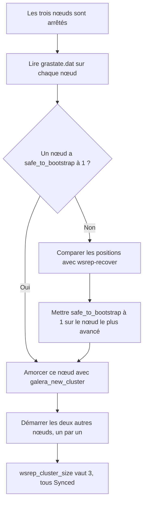

# 06 · MariaDB et cluster Galera

| | |
| --- | --- |
| **Machine(s)** | `DB1` (VM 612), `DB2` (VM 613), `DB3` (VM 614) |
| **Zone et adresse** | BDD (VLAN 166), `10.100.166.3`, `.4` et `.5` |
| **État** | En place (contrôle de santé sur le port 9200 à vérifier) |
| **Référence DAT** | §9, §10, §12, §14, §15 |

> Procédure de référence rédigée à partir du DAT v1.4. Les valeurs marquées *à vérifier* ne sont pas relevées sur la machine : les comparer à l'état réel avant de les citer comme preuve dans le dossier E6. Le script de contrôle de santé (§4.4) a été testé avec un client MariaDB simulé, pas sur le cluster réel.

## 1. Objectif et périmètre

Trois nœuds MariaDB 10.11 répliquent chaque transaction de façon synchrone : la panne d'un nœud ne fait perdre aucune transaction validée. HAProxy n'envoie les écritures qu'à DB1 ; DB2 et DB3 sont des secours. Cette procédure couvre l'installation, l'amorçage, le contrôle de santé lu par HAProxy, la création de la base du site, le démarrage à froid et la sauvegarde logique.

## 2. Valeurs du laboratoire

| Élément | Valeur | Source |
| --- | --- | --- |
| Version | MariaDB 10.11 | DAT §6 |
| DB1 | `10.100.166.3`, nœud principal | DAT §6 |
| DB2, DB3 | `10.100.166.4`, `10.100.166.5`, secours | DAT §6 |
| Nom du cluster | `galera-labo` | Choix de cette procédure |
| Méthode de resynchronisation | `rsync` | Choix de cette procédure |
| Contrôle de santé | HTTP, port TCP 9200, `200` si Synced et Primary | DAT §9 |
| Base du site | `wp2026`, compte limité à cette base | DAT §13 |

**Ports** (flux F4, F5 et F6 du DAT)

| Port | Usage | Qui l'utilise |
| --- | --- | --- |
| TCP 3306 | Requêtes SQL | HAProxy (passe par pfSense) |
| TCP 9200 | Contrôle de santé | HAProxy (passe par pfSense) |
| TCP 4567, UDP 4567 | Réplication du cluster | Les nœuds entre eux |
| TCP 4568 | Transfert incrémental (IST) | Les nœuds entre eux |
| TCP 4444 | Transfert complet (SST) | Les nœuds entre eux |

Les trois nœuds sont dans le même VLAN : pfSense ne filtre pas leurs échanges.

## 3. Prérequis

- Trois VM Debian dans le VLAN 166, adresses fixes, noms uniques (procédure 01).
- DNS pointant vers ADPSQS (procédure 04), pour les noms et les journaux.
- Accès SSH par clé (procédure 03).

## 4. Procédure

### 4.1 Installer les paquets (sur les trois nœuds)

```bash
sudo apt update
sudo apt install -y mariadb-server mariadb-client galera-4 rsync
sudo systemctl stop mariadb
mariadb --version
```

`rsync` sert à la resynchronisation complète d'un nœud (SST). La version affichée doit être `10.11.x`. Les trois nœuds doivent avoir la **même** version.

### 4.2 Configurer Galera (sur chaque nœud)

Fichier `/etc/mysql/mariadb.conf.d/60-galera.cnf`. Il se charge après le réglage par défaut de Debian, qui écoute seulement sur `127.0.0.1` : `bind-address` doit donc être redéfini.

```ini
[mysqld]
bind-address=<ADRESSE_DU_NOEUD>
binlog_format=ROW
default_storage_engine=InnoDB
innodb_autoinc_lock_mode=2

[galera]
wsrep_on=ON
wsrep_provider=/usr/lib/galera/libgalera_smm.so
wsrep_cluster_name="galera-labo"
wsrep_cluster_address="gcomm://10.100.166.3,10.100.166.4,10.100.166.5"
wsrep_node_name="<NOM_DU_NOEUD>"
wsrep_node_address="<ADRESSE_DU_NOEUD>"
wsrep_sst_method=rsync
```

| Nœud | `<NOM_DU_NOEUD>` | `<ADRESSE_DU_NOEUD>` |
| --- | --- | --- |
| DB1 | `db1` | `10.100.166.3` |
| DB2 | `db2` | `10.100.166.4` |
| DB3 | `db3` | `10.100.166.5` |

Le fichier est identique sur les trois nœuds, sauf les deux dernières valeurs. Il ne contient aucun secret : il se verse dans `configs/galera/`.

### 4.3 Amorcer le cluster et ajouter les nœuds

Les nœuds sont arrêtés (§4.1). **Un seul** nœud s'amorce, les autres le rejoignent.

```bash
# Sur DB1 uniquement
sudo galera_new_cluster
sudo mariadb -e "SHOW STATUS LIKE 'wsrep_cluster_size'"
```

La valeur doit être `1`. Puis, **un nœud à la fois** :

```bash
# Sur DB2, puis une fois Synced, sur DB3
sudo systemctl start mariadb
sudo mariadb -e "SHOW STATUS LIKE 'wsrep_local_state_comment'"
```

Attendre `Synced` avant de démarrer le suivant. Un nœud qui rejoint **reçoit une copie complète** de la base d'un autre nœud : ses données d'origine sont remplacées. Sur DB1, `wsrep_cluster_size` doit passer à `3`.

### 4.4 Contrôle de santé sur le port 9200 (sur chaque nœud)

Pourquoi : tester seulement le port 3306 ne suffit pas. Un nœud isolé accepte les connexions mais refuse les requêtes. HAProxy interroge donc un petit service HTTP qui répond `200` **seulement** si le nœud est `Synced` et `Primary` (DAT §9).

**1. Créer un compte sans aucun privilège** (une seule fois, sur DB1 : le compte se réplique) :

```sql
CREATE USER 'galera_check'@'localhost' IDENTIFIED BY '<MOT_DE_PASSE>';
```

Aucun `GRANT` : `SHOW STATUS` n'en demande pas. Si le script fuit, il ne donne accès à aucune donnée.

**2. Sur chaque nœud, préparer l'utilisateur système et le fichier d'identifiants :**

```bash
sudo useradd --system --no-create-home --shell /usr/sbin/nologin galera-check

sudo tee /etc/galera-check.cnf > /dev/null <<'EOF'
[client]
user=galera_check
password=<MOT_DE_PASSE>
EOF
sudo chown galera-check:galera-check /etc/galera-check.cnf
sudo chmod 600 /etc/galera-check.cnf
```

**3. Le script** `/usr/local/bin/galera-check.sh` (à verser dans `scripts/galera/`) :

```bash
#!/bin/bash
# Contrôle de santé Galera, lancé par systemd à chaque connexion sur le port 9200.
# Répond en HTTP : 200 si le nœud est Synced et Primary, 503 sinon.

# Lire et ignorer la requête HTTP (jusqu'à la ligne vide)
while read -r -t 2 line; do
    line=${line%$'\r'}
    [ -z "$line" ] && break
done

OUT=$(timeout 3 mariadb --defaults-extra-file=/etc/galera-check.cnf -N -B \
    -e "SHOW GLOBAL STATUS WHERE Variable_name IN ('wsrep_local_state_comment','wsrep_cluster_status')" 2>/dev/null)
STATE=$(awk '$1=="wsrep_local_state_comment"{print $2}' <<<"$OUT")
STATUS=$(awk '$1=="wsrep_cluster_status"{print $2}' <<<"$OUT")

if [ "$STATE" = "Synced" ] && [ "$STATUS" = "Primary" ]; then
    CODE="200 OK"
    BODY="Galera Synced et Primary"
else
    CODE="503 Service Unavailable"
    BODY="Galera non pret : etat=${STATE:-inconnu} cluster=${STATUS:-inconnu}"
fi

printf 'HTTP/1.1 %s\r\nContent-Type: text/plain\r\nContent-Length: %d\r\nConnection: close\r\n\r\n%s' \
    "$CODE" "${#BODY}" "$BODY"
```

```bash
sudo chmod 755 /usr/local/bin/galera-check.sh
```

**4. Les unités systemd** (à verser dans `configs/galera/`) :

```ini
# /etc/systemd/system/galera-check.socket
[Unit]
Description=Controle de sante Galera (port 9200)

[Socket]
ListenStream=9200
Accept=yes

[Install]
WantedBy=sockets.target
```

```ini
# /etc/systemd/system/galera-check@.service
[Unit]
Description=Controle de sante Galera (une connexion)

[Service]
ExecStart=/usr/local/bin/galera-check.sh
StandardInput=socket
StandardOutput=socket
User=galera-check
```

**5. Activer et tester :**

```bash
sudo systemctl daemon-reload
sudo systemctl enable --now galera-check.socket
curl -i http://127.0.0.1:9200/
```

Résultat attendu : `HTTP/1.1 200 OK` et `Galera Synced et Primary`. Sur un nœud arrêté ou isolé : `503`.

### 4.5 Vérifier la compatibilité avec Galera

Avant d'héberger la base d'un nouvel outil (WordPress, GLPI, Nextcloud), contrôler : tables **InnoDB** uniquement, et une **clé primaire** sur chaque table (DAT §10).

```sql
-- Tables qui ne sont pas InnoDB
SELECT table_schema, table_name, engine
FROM information_schema.tables
WHERE engine <> 'InnoDB'
  AND table_schema NOT IN ('mysql','information_schema','performance_schema','sys');

-- Tables sans clé primaire
SELECT t.table_schema, t.table_name
FROM information_schema.tables t
LEFT JOIN information_schema.table_constraints c
  ON c.table_schema = t.table_schema
 AND c.table_name = t.table_name
 AND c.constraint_type = 'PRIMARY KEY'
WHERE t.table_type = 'BASE TABLE'
  AND t.table_schema NOT IN ('mysql','information_schema','performance_schema','sys')
  AND c.constraint_name IS NULL;
```

Les deux requêtes doivent renvoyer **zéro ligne**.

### 4.6 Créer la base et le compte WordPress

Sur DB1 (la création se réplique sur les autres nœuds). MariaDB voit l'adresse de **HAProxy**, pas celle du serveur web : le compte se crée pour `10.100.164.2` (DAT §12).

```sql
CREATE DATABASE wp2026 CHARACTER SET utf8mb4 COLLATE utf8mb4_unicode_ci;
CREATE USER '<UTILISATEUR_WP>'@'10.100.164.2' IDENTIFIED BY '<MOT_DE_PASSE>';
GRANT ALL PRIVILEGES ON wp2026.* TO '<UTILISATEUR_WP>'@'10.100.164.2';
FLUSH PRIVILEGES;
```

Règle pour les futurs outils (GLPI, Nextcloud, flux F16) : **une base et un compte par outil**, jamais de compte partagé. Tous leurs comptes seront aussi créés pour `10.100.164.2`, puisque le SQL passe par HAProxy.

### 4.7 Sauvegarde logique quotidienne (sur DB3)

Elle complète les images de VM Proxmox (DAT §14). Sur un nœud de secours, elle ne ralentit pas DB1.

```bash
#!/bin/bash
# /usr/local/bin/sauvegarde-sql.sh : export logique de toutes les bases
set -euo pipefail
umask 077

DEST=/var/backups/sql
mkdir -p "$DEST"

mariadb-dump --all-databases --single-transaction --routines --events \
    | gzip > "$DEST/all-$(date +%F).sql.gz"

# Conservation locale : 7 jours (valeur à définir, DAT §14)
find "$DEST" -name 'all-*.sql.gz' -mtime +7 -delete
```

```bash
sudo chmod 755 /usr/local/bin/sauvegarde-sql.sh
echo '30 2 * * * root /usr/local/bin/sauvegarde-sql.sh' | sudo tee /etc/cron.d/sauvegarde-sql
```

Ces fichiers contiennent des données personnelles : droits `root` seul (`umask 077`), jamais dans Git (le `.gitignore` bloque `*.sql.gz`). Une copie **hors du cluster** reste à organiser.

## 5. Démarrage à froid et reprise après panne

Quand les trois nœuds sont arrêtés, **aucun ne repart seul** : il faut en amorcer un, le plus à jour, puis démarrer les autres un par un (DAT §10 et §15). C'est le cas d'erreur **E01** de la matrice d'erreurs.



### 5.1 Arrêt propre

Arrêter les nœuds **un par un** et noter le **dernier arrêté** : c'est le plus à jour, donc celui qu'on amorcera.

```bash
sudo systemctl stop mariadb
```

### 5.2 Choisir le nœud à amorcer

Sur chaque nœud :

```bash
sudo cat /var/lib/mysql/grastate.dat
```

- Un nœud affiche `safe_to_bootstrap: 1` : c'est lui (le dernier arrêté proprement).
- Aucun ne l'affiche (arrêt brutal) : relever la position de chaque nœud.

  ```bash
  sudo -u mysql mariadbd --wsrep-recover 2>&1 | grep 'Recovered position'
  ```

  La ligne `Recovered position: <uuid>:<numéro>` donne la position. Le nœud au **numéro le plus élevé** est le plus avancé. Sur **ce nœud seulement** :

  ```bash
  sudo sed -i 's/safe_to_bootstrap: 0/safe_to_bootstrap: 1/' /var/lib/mysql/grastate.dat
  ```

### 5.3 Amorcer, puis ajouter les autres

```bash
# Sur le nœud choisi
sudo galera_new_cluster

# Sur chacun des deux autres, un à la fois, en attendant Synced entre les deux
sudo systemctl start mariadb
sudo mariadb -e "SHOW STATUS LIKE 'wsrep_local_state_comment'"
```

Un nœud qui revient **rattrape** les transactions manquées (IST, port 4568) ou **recopie** toute la base (SST, port 4444).

### 5.4 Deux nœuds perdus, le dernier refuse les requêtes

Après deux pannes brutales, le dernier nœud passe en `non-Primary` pour éviter des données divergentes. Si les deux autres sont **réellement arrêtés** et que celui-ci porte les données les plus récentes :

```sql
SET GLOBAL wsrep_provider_options='pc.bootstrap=YES';
```

Ne jamais lancer cette commande si un autre nœud est encore actif de son côté : deux groupes se déclareraient chacun Primary.

### 5.5 Mise à jour de Debian ou de MariaDB

Un nœud à la fois, sauvegarde avant, et **attendre `Synced`** entre deux nœuds (DAT §12). Des versions incompatibles dans le même cluster sont le risque.

## 6. Vérification

Indicateurs à lire sur chaque nœud avec `sudo mariadb -e "SHOW STATUS LIKE 'wsrep%'"` (DAT §10) :

| Variable | Valeur attendue | Ce qu'elle dit |
| --- | --- | --- |
| `wsrep_cluster_size` | `3` | Nombre de nœuds dans le cluster |
| `wsrep_cluster_status` | `Primary` | Le nœud est dans le groupe majoritaire |
| `wsrep_local_state_comment` | `Synced` | Le nœud est à jour |
| `wsrep_ready` | `ON` | Le nœud accepte les requêtes |

| Test | Commande ou action | Résultat attendu |
| --- | --- | --- |
| Réplication | Sur DB1 : `CREATE DATABASE test_repl;` puis sur DB2 : `SHOW DATABASES LIKE 'test_repl';` | La base apparaît sur DB2. La supprimer ensuite avec `DROP DATABASE test_repl;` |
| Contrôle de santé | `curl -i http://10.100.166.3:9200/` depuis HAProxy | `200` |
| Accès par HAProxy | `mariadb -h 10.100.164.2 -u <UTILISATEUR_WP> -p wp2026 -e 'SELECT 1'` depuis un serveur web | Une ligne `1` |
| Panne de DB1 | `sudo systemctl stop mariadb` sur DB1, puis ouvrir le site | Le site reste en ligne après quelques secondes, HAProxy bascule sur DB2 (tests T05, T08, S2) |
| Retour de DB1 | `sudo systemctl start mariadb` sur DB1 | DB1 se resynchronise, puis HAProxy lui rend la main après des contrôles réussis |

## 7. Dépannage

| Symptôme | Cause probable | Correction |
| --- | --- | --- |
| `failed to open gcomm backend connection` au démarrage | Aucun autre nœud joignable : cluster arrêté (E01) | §5 : amorcer le nœud le plus à jour |
| `WSREP has not yet prepared node for application use` | Nœud non Primary, ou pas encore Synced | Lire `wsrep_cluster_status` ; §5.4 si le groupe est perdu |
| HAProxy ne voit aucun nœud en ligne | Le port 9200 ne répond pas, ou flux F5 fermé | `curl -i http://127.0.0.1:9200/` sur le nœud, `systemctl status galera-check.socket`, règles pfSense |
| `Access denied for user ... @'10.100.164.2'` | Compte créé pour une autre adresse | §4.6 : créer le compte pour `10.100.164.2` |
| Un nœud n'arrive pas à rejoindre | `rsync` absent, port 4444 fermé, versions différentes | `apt install rsync`, comparer `mariadb --version`, lire `journalctl -u mariadb` |
| Un nœud refuse de démarrer après arrêt brutal | `safe_to_bootstrap: 0` | §5.2 |
| Écritures en échec sur plusieurs nœuds | Conflit de validation (écritures simultanées) | HAProxy n'envoie les écritures qu'à DB1 : vérifier qu'aucun client ne vise un autre nœud |

Les journaux se lisent avec `journalctl -u mariadb` : démarrages, état WSREP, arrivées et départs de nœuds, SST et IST.

## 8. Preuves à conserver pour le dossier E6

Captures à déposer dans `captures/galera/` :

- `01-wsrep-cluster-size-3.png` : `wsrep_cluster_size`, `Primary`, `Synced`, `ON`.
- `02-controle-sante-9200.png` : réponse `200` d'un nœud sain.
- `03-replication.png` : base créée sur DB1 et visible sur DB2.
- `04-panne-db1-haproxy.png` : page de statistiques HAProxy avec DB1 en rouge et DB2 actif.
- `05-demarrage-a-froid.png` : amorçage d'un nœud et retour des deux autres.

## 9. Points à vérifier

- [ ] Réglage réel de Galera sur chaque nœud, comparé au §4.2.
- [ ] Présence et fonctionnement du contrôle de santé sur le port 9200 (script et unités réels, DAT §18).
- [ ] Compte du contrôle de santé sans aucun privilège.
- [ ] Mot de passe de test utilisé pendant la mise en place de Galera : à remplacer (DAT §13).
- [ ] Planning, conservation et copie hors cluster de la sauvegarde logique.

## 10. Références

- [Galera : quorum, surveillance et reprise](https://mariadb.com/docs/galera-cluster/high-availability/understanding-quorum-monitoring-and-recovery), MariaDB.
- [Galera : configuration et ports](https://mariadb.com/docs/galera-cluster/galera-management/configuration/configuring-mariadb-galera-cluster), MariaDB.
- [Galera : premiers pas et amorçage](https://mariadb.com/docs/galera-cluster/galera-management/installation-and-deployment/getting-started-with-mariadb-galera-cluster), MariaDB.
- [Galera : limites connues](https://mariadb.com/docs/galera-cluster/reference/mariadb-galera-cluster-known-limitations), MariaDB.
- [Redémarrer un cluster Galera](https://galeracluster.com/library/training/tutorials/restarting-cluster.html), Galera Cluster.
